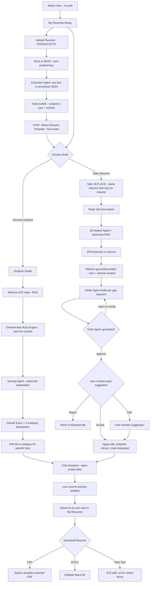
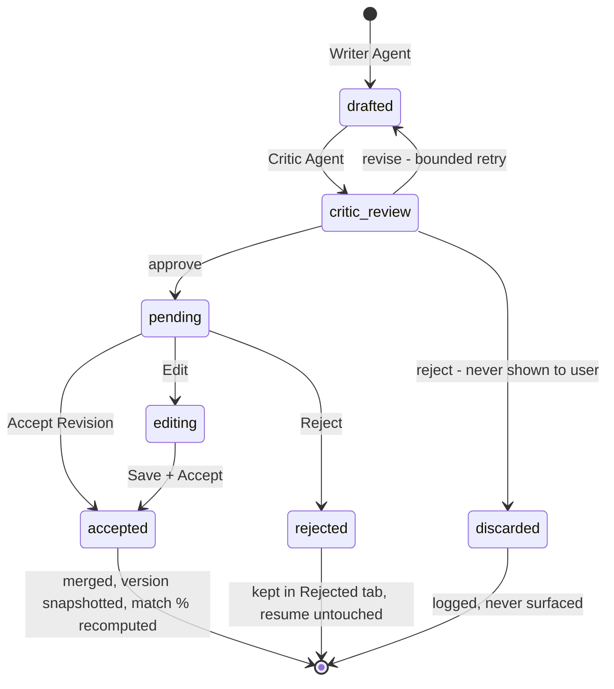
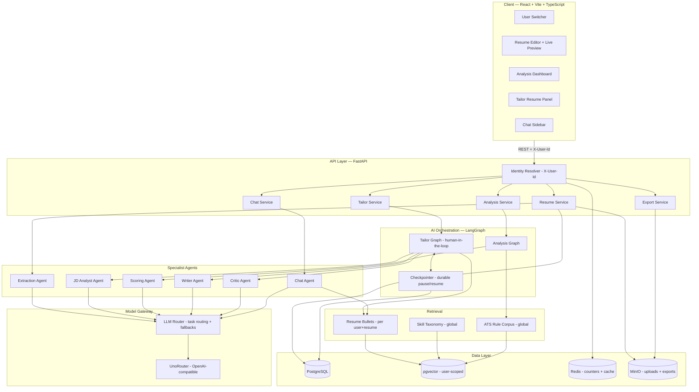
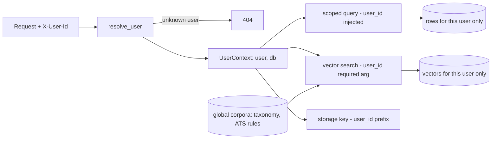
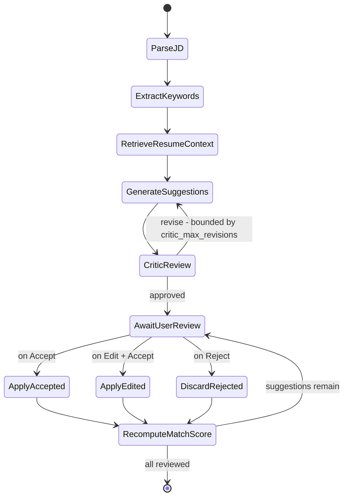
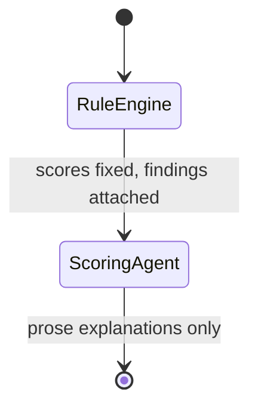
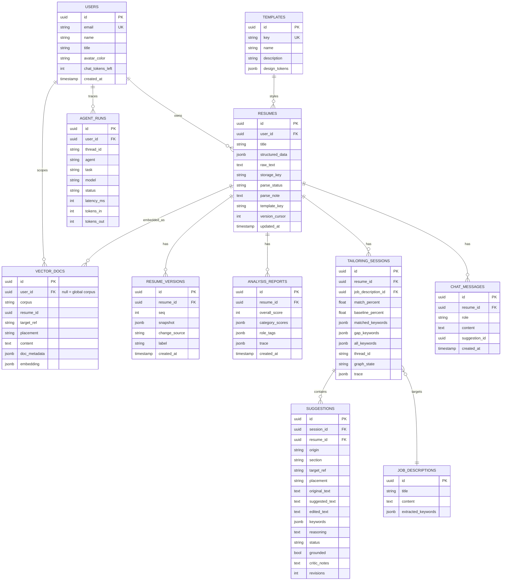
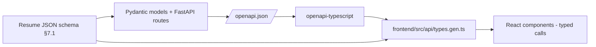
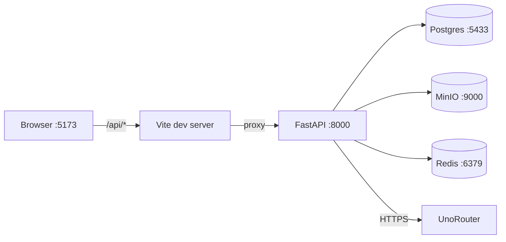

# ResumeAI — Product Design Document
### AI Resume Analysis & Tailoring Platform

**Status:** Design · **Owner:** Product/Eng

---

## 1. Executive Summary

ResumeAI is a web app where a job seeker uploads a resume, picks a visual template, and then uses two AI-powered modes to improve it:

- **Resume Analysis** — an ATS-style score (0–100) with a category-by-category breakdown and specific fixes.
- **Tailor Resume** — paste a job description and the app rewrites resume bullets to close keyword gaps, with every AI change surfaced as an **Accept / Reject / Edit** card so the user stays in control.

A persistent AI chat sits alongside the editor for open-ended help, and the resume renders live so changes are visible immediately.

### Operating parameters

| Parameter | Decision |
|---|---|
| Deployment | Runs locally via `docker compose`; single node |
| Authentication | **None.** Active user resolved from an `X-User-Id` header |
| Users | 5 seeded local users, chosen from a UI switcher |
| Scoping | Per-user — one user's resume content never grounds another user's suggestions |
| Model gateway | NVIDIA NIM + Groq, both OpenAI-compatible, behind one client (§6.4) |
| Model routing | Per task via `MODEL_*` in `backend/.env`; writer and critic pinned to different vendors |
| Orchestration | LangGraph multi-agent graphs with human-in-the-loop interrupts |
| Retrieval | RAG over pgvector — three corpora |
| Object storage | MinIO (S3 API) |
| Input / output | PDF, DOCX, TXT in · PDF, DOCX, TXT out |
| Language | English resumes first |

---

## 2. Goals & Non-Goals

**Goals**
- Parse an uploaded resume into structured, editable data with high fidelity.
- Score resumes against ATS/recruiter heuristics and explain *why*, not just *what*.
- Tailor a resume to a job description while keeping every claim truthful — grounded in the user's actual content, no fabricated experience.
- Keep the human in the loop: every AI edit is reviewable before it touches the document.
- Route across multiple models so the product isn't single-vendor dependent and can fail over or route by cost.
- Keep the five local users independent — enforced structurally, not by convention.
- Make agent behaviour auditable without an external tracing SaaS.

**Non-goals**
- Job board integration / application tracking.
- Cover letter generation (a fast-follow on the same pipeline).
- Multi-language resumes.
- Multi-tenancy. One workspace, five users. §6.2 records what re-adding tenancy would cost.
- Authentication, authorization, billing. Scoping here is **data hygiene, not a security boundary** — see §12.
- Horizontal scale. Single-node by design.

---

## 3. User Flow



---

## 4. Screen-by-Screen UX Spec

### 4.1 User Switcher (top bar)
One dropdown, five seeded users. Switching re-scopes every panel — resume list, analysis, tailoring sessions, chat history. The active user is sent as `X-User-Id` on every request. This replaces a login screen.

### 4.1.1 Theme toggle (top bar)
A sun/moon button beside the user switcher, present on every screen (library, template step, workspace).

- **Stored per user, not per browser.** Five demo personas share one machine, so a single global key would mean switching user silently rewrote someone else's preference. The key is `resumeai.theme.{user_id}`.
- A user who has never chosen inherits the `anonymous` slot, so a theme picked before a user is resolved is not thrown away on first switch.
- **Dark is the product default**; an unreadable or missing stored value falls back to it rather than throwing.
- The class is applied by an inline script in `index.html` that runs **before the bundle**, because setting it from React paints one dark frame first and reads as a flicker. That script duplicates the storage-key format on purpose — it cannot import — so the two must be changed together.
- The button shows the theme you would *get* (a sun while dark), with an `aria-label` that says so in words.
- Light-theme pairs were checked against WCAG AA; note the brand inversion trap in `index.css` §3 — `#4737FF` is unusable as text on dark and `--brand-400` is unusable on light, so the same role takes opposite values per theme.

### 4.2 My Resumes (home)
- Landing screen. Every resume — base or tailored — is a card.
- Tabs **All / Base / Tailored** with counts, plus title/role search.
- Each card: live thumbnail of the real content, inline rename, `Tailored: <role at company>` subtitle, relative "last updated", strength ring, a primary action (**Tailor to a job** / **Continue Tailoring**) and an overflow menu (Duplicate, Open editor, Delete).
- Strength bands are **<60 Needs work · 60–79 Good · 80+ Strong**. A resume that has never been analysed shows `–` and "Not analysed yet", **not 0%** — zero would read as a terrible resume rather than an unmeasured one.
- Analysis is never run automatically; the score appears once the user runs it from the editor.

### 4.2.1 Resume forking
Tailoring edits the resume **in place**. Forking is available per request (`fork: true` on `POST /tailor`) and is what lets one base serve many applications while staying pristine.

In-place is the default because the Analysis and Tailor tabs must describe the same document. When tailoring forked by default, the session bound to the new child while the Analysis tab stayed on the id in the URL — so accepting a suggestion in Tailor changed a resume, just not the one Analysis was reading, and the edit looked like it had silently failed. Every call site reads the working id off `session.resume_id` rather than assuming, which is what lets both modes coexist.

In-place edits are reversible through the ordinary version cursor (`POST /undo`); each accepted suggestion records a version.

| Copied | Not copied |
|---|---|
| `structured_data`, `template_key`, `raw_text`, `storage_key` | versions, analyses (a fork starts its own history) |
| **grounding vectors** | |

The vector copy is load-bearing, not an optimisation: the writer agent retrieves grounding bullets scoped to `resume_id`, so an unindexed fork would silently produce weaker, ungrounded suggestions with no error anywhere.

Columns on `resumes`: `kind` (`base` \| `tailored`), `parent_id` (nullable self-FK), `tailored_for` (denormalised JD label for the card subtitle).

**Deleting a base orphans its forks rather than cascading** — deleting your base must never silently delete the tailored versions already sent to employers. Orphaning is done explicitly in the service, not via `ON DELETE SET NULL`, because SQLite does not enforce FK actions unless `PRAGMA foreign_keys` is on and the behaviour must not differ between backends.

A fork shares its parent's `storage_key`, so deletion only removes the uploaded object when **no other resume references it**.

### 4.3 Import Resume (modal)
- Fields: Resume Name, drag-and-drop upload (PDF/DOCX/TXT), live preview pane.
- On upload: validate type and size → store in MinIO under `{user_id}/{resume_id}/{filename}` → trigger async parse → spinner → editor once parsed.
- Parsing reads the file back *out of object storage*, so the pipeline is identical whether storage is MinIO or real S3.

### 4.4 Template Selection (step)
- A **forced full-screen step** immediately after upload and extraction — not a modal. After extraction the user has never seen their resume rendered, so this is the first moment the parse becomes visible and it doubles as a "did we read your file correctly?" check. A quiet warning appears when extraction looks thin (no experience entries, or a missing name/email).
- The same grid is reachable later from the workspace as a modal to change template; both render one shared `TemplateGrid`, so they cannot drift.
- Grid of **7 templates**, each rendered with the user's *actual* parsed content once parsing completes, so the choice is realistic.
- Each card shows the template name, its description, a scaled full-page live preview, and a footer summarising the typeface, density and header style.
- Non-destructive: content is decoupled from layout, so switching never loses data.

#### Design-token contract
Styling lives in `templates.design_tokens` (JSONB), defined once in `seed.py` and read by **both** renderers — the live HTML preview and the fpdf2 exporter. Adding or restyling a template is therefore a **backend-only change**; no frontend edit is required, and the preview cannot drift from the downloaded file.

| Token | Values | Effect |
|---|---|---|
| `font` | `sans` \| `serif` | Helvetica or Times (fpdf2 core fonts — no font files ship) |
| `heading` | `rule` \| `underline` \| `plain` \| `boxed` \| `sidebar` | Section-heading treatment; `rule` tints its line with the accent |
| `name_align` | `left` \| `center` | Header alignment |
| `accent` | hex or `""` | Name and heading colour; `""` inherits ink |
| `density` | `airy` \| `normal` \| `dense` | Line height and heading gap |
| `caps` | bool | Uppercase section headings |
| `divider` | bool | Rule under the contact block |
| `header` | `stacked` \| `split` | Name above contact, or name left / contact flush right |
| `entry` | `stacked` \| `inline` | Role above company, or `Role - Company` on one line |
| `skill_columns` | 1–3 | Skills laid out as a column grid |

A `split` header requires `name_align: left` — centring the name while floating contact right would collide. This is asserted in the test suite.

| Template | Font | Header | Entry | Cols | Accent |
|---|---|---|---|---|---|
| Modern | sans | stacked | stacked | 2 | `#4737ff` |
| Executive | serif | split | stacked | 3 | `#A2643C` |
| Balanced | sans | stacked | stacked | 1 | `#5F8A7D` |
| Classic | serif | stacked | stacked | 1 | — |
| Minimal | sans | stacked | stacked | 2 | — |
| Compact | sans | split | inline | 3 | — |
| Technical | sans | stacked | inline | 3 | `#3529bf` |

Dates are flushed to the right margin in every template — that is what makes a printed resume scannable by date. `contact.headline` (the professional title under the name) is optional and renders only when present; the parser extracts it from the line following the name, rejecting anything that looks like contact data or a section heading.

**Export caching:** the object key is `{user_id}/{resume_id}/v{version_cursor}-{template_key}.{fmt}`. The template key is part of the cache identity because applying a template does *not* bump `version_cursor`; without it the bucket would serve the previously rendered PDF forever.

**TXT is deliberately style-free** — it exists for ATS paste boxes, so the template must not affect it.

### 4.5 Main Workspace
- **Left** — tabs: "Resume Analysis" / "Tailor Resume". The active tab lives in the URL (`?tab=`), so "Continue Tailoring" is linkable and a refresh keeps your place.
- **Center** — AI chat: message history, quick-action chips, inline suggestion cards. See §4.5.1.
- **Right** — live rendered resume, zoom, "Templates & Settings", **Download**.

Entry points set the tab deliberately: the card's strength ring opens **Analysis**, its primary button opens **Tailor**. Arriving on the wrong tab would make the button feel broken.

#### 4.5.1 Chat assistant (centre pane)
The centre column is a **fixed 380px**, not a flexible one: chat lines past roughly 70 characters are hard to scan, and the spare width is better spent on the resume preview, which is the pane that benefits from it.

- Message history, user right / assistant left, with an empty state that states the review guarantee up front.
- **Quick-action chips are rendered verbatim from the backend `quick_actions` strings.** The backend owns that copy so the list can change without a frontend release; the UI adds no icons and keeps no local fallback list.
- **Chat never edits the resume directly.** A reply that proposes a change carries a `suggestion_id`, which renders as an inline Accept/Reject card and goes through the same review path as tailoring (`origin='chat'`, §5). This is what makes the assistant safe to trust: it cannot apply anything on its own, and it is prompt-bound never to claim it did.
- The user's own message appears optimistically and rolls back if the POST fails — waiting on a multi-agent round trip before echoing typed text reads as a hang. The assistant reply is never faked.
- **Message budget.** 25 per demo user (`users.chat_tokens_left`). The counter is hidden until 5 remain, then shows as a warning: a permanent counter makes a generous allowance feel like a meter running down. At zero the composer is **disabled with the reason shown**, because the backend returns 429 and letting the user type into a box that will reject them is worse than saying so.
- Three panes need width; below ~1280px the preview collapses and the tools + chat remain, since those are the working surfaces and the preview is reference.

### 4.6 Resume Analysis tab
- Empty state with a single **Run analysis** button — analysis is never automatic (it costs a model call, and an unrequested score on upload reads as a judgement nobody asked for).
- Once run: score ring, band label, **"N points to reach 80+"**, total finding count, role/level tags, and a re-run control.
- Four category cards (contact 15 / summary 20 / experience 45 / format 20) with progress bars and finding-count badges, expanding on click to list the notes.
- A 404 from `GET /resumes/{id}/analysis` is the **normal "never analysed" state**, not an error: the client treats it as an empty state and does not retry.

**Parse facts: what we saw while reading the upload.** The rule engine grades CONTENT only, and deliberately so — layout is a property of the template and is fixed in the exporter rather than nagged about on every analysis. That reasoning covers documents *we* render; it says nothing about the file the user handed us, which the exporter never saw and cannot repair. `parse_facts` records what the reader observed (page count, extractable characters, whether the PDF has no text layer, how many pages carry a two-column gutter, DOCX layout tables, unrecognised section headings) and `GET /parse-status` turns those facts into plain-language advisories.

They are **advisory and unscored**: no new finding id, no change to `WEIGHTS`, no change to any `Δscore == points` assertion. The score answers "is this resume good"; these answer "could a parser read the file you uploaded", and a user cannot fix a scanned PDF by editing text. The sentences are derived on read rather than stored, because the facts never change but the advice we choose to give about them will. Detection is deliberately conservative — an early version reported the candidate's own name as an unrecognised section, since "Jane Doe" and "My Journey" are the same shape; a heading now has to be set off by blank lines and sit below the contact block.

**Clickable findings — resolved.** The rule engine now emits structured `Finding` objects rather than plain note strings, and each one carries a `target_ref` (§8 grammar) naming the exact field it judged. `category_scores[c].notes` is still emitted, derived from `[f.message]`, so existing clients keep working.

```json
{
  "id": "experience.unquantified_bullets",
  "category": "experience",
  "target_ref": "exp_0.bullet_2",
  "severity": "high",
  "points": 7,
  "message": "Only 3 of 8 bullets are quantified",
  "fix_hint": "Add the number you moved: %, time saved, revenue, scale.",
  "action": "rewrite",
  "meta": { "quantified": 3, "total": 8 }
}
```

### 4.6.1 Guided step editor

A second mode of the Analysis tab (not a route, so the live preview stays mounted beside it and moves as the user types). The section list shows the four scoring categories; clicking one opens a focused step that pairs its recommendations with the editable fields they refer to.

- **`GET /resumes/{id}/analysis/steps`** backs it. Unlike `GET /analysis` it is **computed live from the current `structured_data` on every call**, so it never 404s on "never analysed" — the guided flow is what produces the first score — and a resolved recommendation disappears within one autosave of the keystroke that fixed it. A cached report would leave "+3 points" cards sitting under a field the user already corrected.

- **The step response also carries `commentary` and `commentary_stale`.** The ScoringAgent's `headline` and per-category notes were generated by a model call on every analysis, persisted into `trace`, returned by `GET /analysis` — and rendered by no screen. The guided editor is where per-category advice is actually useful, so it now receives it. **It is a snapshot travelling next to live findings**, which is a genuine conflict: edit a bullet and the prose describes text that no longer exists, while reading as the authoritative half of the pair. `AnalysisReport.trace.data_fingerprint` (a hash of the `structured_data` the prose was written about) makes the mismatch detectable, and the UI stamps it "From your last analysis" and dims it rather than re-running an LLM call on every step entry. A report with no fingerprint cannot prove freshness and is reported stale — the safe direction, since an unnecessary note costs nothing and silently presenting stale prose as current is the failure being prevented.

- **The score is computed, never replayed.** Three surfaces show a strength number — the library card, the Analyze tab header and the guided stepper — and all three now derive it from the current `structured_data` on every read. Only the stepper used to: `GET /analysis` replayed the `AnalysisReport` row written by the last `POST /analyze`, and `list_resumes()` read the same row through a grouped query. **This reversed an earlier decision** that the stored report should stay frozen until re-analysed (it was asserted by a test, `frozen == stale`). It was wrong for a reason no amount of caching could fix: fix recommendations in the guided editor and the score climbs 79 → 93, switch to Tailor and back, and the Analyze tab says 79 again — the same resume, the same sitting, two answers. Invalidating the query just refetched the stale number. The split is now drawn where the **cost** is, not where the storage is: the deterministic half (score, `category_scores`, notes, findings) is a pure function of the resume with fixed weights, so it is recomputed; the LLM-authored half (`commentary`, `ats_review`, `role_tags`) genuinely is a snapshot, because regenerating it is a model call per page view, so it keeps the `commentary_stale` stamp the guided editor already used. Two consequences are deliberate: `latest()` returns a **dict, not the ORM row**, because overlaying fresh numbers onto the instance would mark it dirty and the next commit would rewrite the historical record — a read must not become a write; and `overall_score` stays `None` for a never-analysed resume, because "never analysed" is a state the library renders differently and a computable number would erase it.

- **`SuggestionOut.score_delta`** prices a tailoring suggestion in the same currency the Analysis tab prints. Keyword match answers "does this look like the job ad" and cannot answer "is my resume getting better or worse"; a user could reach 100% keyword match with no idea what it did to their score. The number is deterministic and free — apply the patch to a copy, rescore with the same rule engine, subtract — and `introduced_findings` was already computing the patched score during review and discarding it. `0` is the common case and is shown as "no score change" rather than hidden. It should never be negative: the review gate rejects any draft that introduces a finding and `Δscore == points` holds, so a negative value means that gate has a hole, and it is surfaced rather than clamped so the hole stays visible.
- **Experience findings are grouped by role; every other step stays a flat list.** Experience is the only step with repeating subjects — `weak_verb` can fire five times, once per job, and in a flat list the five cards are identical except for a `target_ref` the user never sees. The grouping is derived client-side from the ref (`exp_2.bullet_1` → role 2) joined against the `structured_data` already in the editor, so it costs no backend change and no extra call. The first role is expanded and the rest collapsed, because the top role draws most of the findings and most of the recruiter's attention, and five open groups is exactly the wall of cards the grouping exists to prevent. A ref whose index is past the end of the array — the user deleted a job after the analysis ran — is rendered **ungrouped rather than under an invented heading**: a finding the user cannot see is a point they cannot win. `frontend/scripts/test-group-findings.mjs` pins the partitioning, including that case.

- **"Fixed with AI" is a session-only acknowledgement, deliberately not persisted.** Because the step response is recomputed live, accepting a rewrite makes the finding *absent* from the next call — the card simply vanishes, which is a poor confirmation that the thing the user just clicked did anything. The parent keeps the resolved finding in component state and re-renders it as a green, collapsed card with its `+N pts applied`. It is held only for findings the server has since dropped, so a partial fix that leaves the finding standing claims nothing. There is no "fixed" state on the server and none is wanted: this is a congratulation, not data, and it is correct for a refresh to clear it.

- **`POST /resumes/{id}/sections/{ref}/rerank` — reordering, the fix for the one finding that never had one.** `ats.not_reverse_chronological` was detectable and scored from the start, but carried `action=""`: it told the user to put their roles newest-first and then offered no control that could do it. The endpoint sorts experience reverse-chronologically using **`resume_ops.experience_sort_key` — the very function `ats.out_of_order_experience` grades with**. That shared key is the point: writing a second ordering here would repeat the bug class this repo has already hit twice (`REVISER`'s word limit disagreeing with `summary.too_short`; `COMPOSER`'s upper bound with no floor), where guidance contradicts the rule it is scored against. Undated entries sort last and keep their relative order — `_sort_key` returns `(0, 0)` and the sort is stable.

- **A rerank is safe because it can only permute.** A rewrite can fabricate, which is why `_hard_check` and a measured writer corpus exist. A reorder cannot, *provided* the output is the same multiset as the input — so `_assert_permutation` checks exactly that before anything is saved, and it lives in the service rather than in a prompt so it stays true no matter what picks the order later: a rule, a model, or a user's drag. It is a cheap total check, not a heuristic, and the test suite breaks it deliberately to prove it can fail.

- **Reordering versus positional refs.** `target_ref` is positional (§7.1), so moving an entry re-points every outstanding suggestion under it at a different role. The one-click rerank therefore **409s while any pending suggestion targets the section** — the overlap `DESIGN.md` already promised would never happen, now enforced rather than assumed. A **manual drag in the editor deliberately does not refuse**: that is the user explicitly rearranging their own document, and the drift is caught afterwards by `SuggestionOut.is_stale`. That gap is now closed. `is_stale` used to compare *text* only, so a bullet duplicated byte-for-byte across two roles could survive a reorder unflagged and apply to the wrong job. It now also compares **identity**: the `placement` recorded when the suggestion was written ("Acme — Senior SRE") against the placement the ref resolves to now. A ref that has moved to a different employer is stale even when the text still matches. The check fires only when the stored string is recognisably a placement for that section — analysis-origin rows historically stored the finding message in that column, and an anchor matching nothing would have marked every one of them stale, which is a worse bug than the one being fixed.

- **Drag ordering uses `@dnd-kit/core`.** The dependency buys one thing that is tedious and easy to botch by hand: operating the list without a mouse. `KeyboardSensor` plus `sortableKeyboardCoordinates` gives arrow-key reordering and screen-reader announcements, and mouse-only drag would be worse than no drag. Entries carry no id and the editor clones the document on every keystroke, so neither index nor object identity is usable as a drag id; `useStableIds` issues ids from a monotonic counter held in state and permutes them in lockstep with the data. It adjusts that state *during* render rather than in an effect, which is React's documented pattern for deriving state from changed input and avoids committing a frame in which a new entry has no id.

- **Step 4 (Format & Structure) carries a bulk action no other step has.** Its findings split three ways: one is deterministic (`ats.not_reverse_chronological` → rerank), one can be drafted by the writer (`format.overlong_bullets`), and five — no skills section, no education, too thin, too long, unparseable dates, decorative glyphs — need information or a judgement only the user has. The reference's button says "Format My Resume / Apply formatting fixes"; **ours deliberately does not**, because a button making that claim while leaving five findings standing is a promise the product cannot keep. The copy states the counts before the click and the summary states what actually happened. The ordering is load-bearing and tested: deterministic fixes run **first**, because a reorder is refused while suggestions are pending on the section, so drafting first would make the reorder 409 against drafts the same action had just created. A single refusal — typically the writer declining a fact only the user knows, which the corpus grades as correct — must not abandon the rest of the queue. Both rules live in `formatFixes.ts` rather than the component and are pinned by `frontend/scripts/test-format-fixes.mjs`.

- **Bulk-created drafts are handed back to the cards.** `RecommendationCard` holds its draft in local state set by its own mutation, so a Suggestion drafted by the bulk action would exist on the server and be invisible in the UI — the user would see unchanged cards and conclude the button did nothing. The runner returns drafts keyed `finding.id::target_ref` and the stepper passes them down as `presetDraft`. A locally started draft still wins, and resolving a preset draft latches it dismissed, or it would spring back from the parent on the next render.

- **The suggestion type pill is not the reference's pair.** The reference prints `MODIFICATION` versus `CONTEXTUAL MATCH`, but `CONTEXTUAL MATCH` labels its clarifying-question card — a mechanism not yet built — and a pill naming an unreachable state is worse than no pill. `suggestionKind()` discriminates on what the data actually separates today (`keywords.length > 0` → "Keyword match", else "Rewrite") with the union left open for the third case to be added in one place. `grounded` was considered and rejected as the discriminator: it is set to `true` at every call site that creates a Suggestion, so a pill derived from it would read identically on every card forever. A second marker flags suggestions whose `origin` is `analysis`, because those surface in the Tailor tab too and a keyword-less card there otherwise looks like a poor tailoring result rather than something that was never about the job description.

- **"What's Working Well" is the one feature with an incentive to lie.** Every other part of the analysis is adversarial towards the resume — the rule engine emits findings, and a finding is by definition a problem. `CategoryStrengths` is the only thing asked to say something positive, so it is the only thing that can flatter. It rides on the **same `ScoringCommentary` model call** as the per-category notes, which costs no extra tokens and means the praise cannot contradict the advice printed beside it; two calls could. Explicit per-category fields, never `dict[str, list[str]]` — an open map renders `additionalProperties: {...}` and Groq's strict `json_schema` mode rejects it on every model at once, which is the failure `CategoryNotes` exists to document.

- **The prompt asks for evidence; `_clean_strengths` enforces it.** A prompt is a request, a filter is a guarantee. Three deterministic rules, no judgement calls: a category scoring **under half its maximum gets nothing** (praise that contradicts the number printed next to it is flattery by construction); any claim containing a **number absent from the resume is dropped**, reusing `unverifiable_numbers` — the same digits-only guard that catches a writer inventing a metric, because "demonstrates 40% cost savings" with no 40 anywhere is the identical fabrication in a friendlier voice; and the list is **capped at 3**, since padding to a fixed length is the vacuity failure the writer corpus already taught us to watch for. The cap is applied *after* the number filter, so three fabrications cannot crowd out three real strengths. Semantic flattery — "excellent formatting" about mediocre formatting — survives all three and no regex will catch it; that is a critic's kind of problem, and the score floor is the blunt instrument that keeps it bounded.

- **With no model, there are no strengths.** The rule-engine fallback returns `{}` rather than deriving praise from passing checks: every check emits a finding or stays silent, so "this check passed" is the only raw material available, and turning that into a compliment is exactly the padding the LLM path is filtered to prevent. An empty list is therefore a real, expected answer, and the UI renders nothing rather than an empty-state message — the score and the recommendations below already say it, more precisely.

- **The clarifying question is the one place the grounding rule is suspended, so it is suspended explicitly.** Every other guard in the system — `_hard_check`, the critic, `introduced_findings`, `MAX_FABRICATED_EXPANSIONS = 0`, the digits guard — compares a draft against text the resume already contains. A free-text answer box introduces a second source of truth that none of them can see. That is not a reason to refuse the feature: a résumé *is* the user's own assertion, and a tool that will not let someone add a true fact about themselves is useless. It is a reason to **record the provenance instead of erasing it**. `grounded` keeps its narrow meaning (*supported by existing resume text*) and is set **false** on these; a separate `attested` column carries the user's word, and `versions.record(change_source="attested")` puts it in the one log that outlives the suggestion row. A year later, "did this line come from the resume or from a box someone typed into?" is still answerable.

- **Which gaps become questions is a filter, not a judgement.** `extract_keywords` is a word counter with a stopword list, so a real posting yields gaps like `across`, `define`, `looking`, `own` and `mean` beside `gitops`. A question card reading "do you have experience with 'across'?" would discredit the feature on first use, so a gap is only asked about if it resolves in `SKILL_TAXONOMY` — the same table that lets `k8s` match `Kubernetes`, which means the question filter and the keyword matcher can never disagree about what a skill is. The taxonomy is small, so genuine skills outside it produce no question; that is the right direction to fail, because a missing question is invisible and an absurd one is not.

- **The question asks for evidence, not for confirmation.** "Do you have experience utilizing X in a professional environment?" prints its preferred answer on itself and invites a yes from anyone skimming — and yes is the answer that makes work appear on screen. Ours name the skill, ask *where and what you did with it*, and state the do-nothing option in the sentence: "if you have not, leave this blank and reject the card." The wording is a deterministic template, never model-generated: a generated question is a fifth call whose only possible failure is a worse question, and a posting is untrusted text pointed straight at the user.

- **A bare "Yes" may attest a capability, never a duration.** A skills-list entry claims no employer, no dates and no outcome, which is exactly the scope of a yes — so plain tool-familiarity questions get a button. When the posting attaches a duration to the keyword (`3+ years with Redis`), `requires_text` flips and the button is refused with a 422: pressing it would write a specific number into the resume as the user's own word when the user never typed a number at all. Duration detection is scoped to the **line** containing the keyword; a ±60-character window read across a newline on the very first real posting and reported "3+ years of GitOps" — a requirement the employer never wrote, quoted back as if they had.

- **Declining is a first-class outcome with a 200, and it is never softened.** An answer that does not name the skill produces no suggestion at all, rather than a vague "familiar with X" — that vague save is the specific failure the feature exists to avoid. The answer is still stored, including the one that declines: *asked and said no* is worth keeping. Questions lead the `active` bucket rather than forming a fourth one, because a tab the user has to remember to visit is a tab that collects unanswered questions.

- **Autosave, no Save button** — debounced ~800 ms through `PUT /resumes/{id}/data`, flushed on step change and unmount so an arrow click cannot drop the last edit. Status is surfaced as Saving / Saved / Not saved rather than claimed silently.
- **"Fix this"** scrolls to and focuses the field named by `target_ref`, which is the payoff for making findings addressable.

**`+N points` is a contract, not decoration.** Each finding's `points` is computed as `max_achievable - awarded` for the single check that produced it, so resolving it raises `overall_score` by exactly N. This is enforced in three places: `backend/tests/test_findings.py` breaks a field, reads the promised number, fixes it and asserts the delta matches; `tests/test_steps_api.py` repeats the check end-to-end over HTTP; and `verify-api-surface.mjs` asserts it against the running server. A per-category assertion also guarantees findings never promise more than the category's remaining headroom. If that arithmetic ever stops holding, the badge should be removed rather than softened — a number the user can verify and catch being wrong costs more trust than showing none.

**Increment scope.** The guided editor now edits contact, summary, experience (with structured dates and location), education (field of study, grade, dates) and skills. The additional sections — certifications, languages, references, awards, publications and custom sections — are approved but still pending, because each one costs both exporter renderers plus the preview, and a field the PDF silently drops is its own kind of lie.

### 4.6.2 Structured dates

`experience`, `education` and `projects` carry `start_date`, `end_date` and `current` instead of one free-text `dates` string. That is what makes tenure, gap detection, ordering and a real "Present" label possible.

Two rules keep the migration honest:

1. **Never guess.** `split_dates()` accepts only ranges it is sure of — a whitespace-padded separator (`Jan 2020 – Present`, `March 2018 to June 2021`) or the tight numeric form (`2019-2022`). Anything else (`Summer 2020`, `Jan-2020`, a bare `2020`) is preserved verbatim in `raw_dates` and rendered exactly as written. A resume that misstates employment dates is far worse than one showing an odd string, and the editor offers to convert it rather than doing so silently.
2. **Never let display drift from data.** `resume_ops.date_label()` is the single accessor every renderer calls — both exporters, plain-text flattening and the scoring engine. The stored `dates` key is a derived mirror refreshed by `normalise_entry()` on every write, never an input once structured fields exist.

`migrate()` runs on parse, on `PUT /resumes/{id}/data` and on seed, and is idempotent, so parsed, seeded and hand-edited documents are the same shape from the first byte.

**The client implements the same rule twice, on purpose.** The preview renders the user's *unsaved* draft, so it cannot round-trip to the server for a label mid-keystroke; `src/lib/dates.ts` mirrors `date_label()`. Two copies of a rule drift, so `frontend/scripts/verify-date-parity.mjs` transpiles the real TypeScript module and compares it against the real backend across structured combinations, legacy migration and idempotence (33 checks, green against both the API and the mock).

**"Currently work here"** disables the end-date input rather than hiding it, and deliberately does **not** clear the stored value — mis-clicking a switch is easy, and silently destroying a date the user typed is not recoverable. `date_label()` ignores `end_date` whenever `current` is true, so a retained value can never leak into the rendered resume.

**PDF encoding.** The date split surfaced a latent export bug: `_latin1()` used `errors="replace"`, so the en-dash in a date range — and every curly quote, em-dash and ellipsis that Word and Google Docs autocorrect into pasted text — rendered as a literal `?`. It now transliterates to ASCII first and replaces only as a last resort. `tests/test_export_dates.py` renders all seven templates and asserts both that the dates appear and that no `?` survives.

### 4.7 Tailor Resume tab
- Empty state leads to the **job-description modal** (title + body, with a "Use sample JD" shortcut for demos).
- Starting a tailoring run edits the resume **in place** (§4.2.1), so the UI stays on the same resume and simply opens the Tailor tab. It still navigates to `session.resume_id` rather than the id it sent, so an opt-in `fork: true` run lands on the child instead of stranding the user on an untouched base.
- Match % bar showing movement from the baseline, plus matched/gap keywords.
- Tabs: **Active** / **Already Matched** / **Rejected**, each with counts.
- A line above the match bar names the resume being edited, because tailoring is in place: *Editing {title} · accepted changes appear in Analysis and in your export*.
- Within a tab, suggestions are **grouped by section** (summary → experience → projects → education → skills → other) with a count and the keywords that group would add. A flat list cannot answer "where is the work"; the grouping lets a user skip a whole section at a glance. Order is fixed rather than by arrival so the list does not reshuffle as cards are accepted, and a suggestion whose section cannot be determined is shown under **Other** rather than dropped.
- Each card: keyword chips, placement (company · role), original text struck through, modified text with keywords highlighted, reasoning, critic notes, and **Accept / Reject / Edit**. Edit opens an inline textarea and accepts the user's own wording.
- Keyword highlighting escapes regex metacharacters and matches longest-first, so `C++` and `Node.js` survive and `Node.js` is not shadowed by `Node`.
- Cards show a **grounding badge** from the critic. Suggestions the critic rejected never render.

### 4.8 Accepted edits in the preview
- Accepting a suggestion already patched `structured_data`, so the preview showed the new text — **silently**, with nothing to say which line was new or where it came from.
- Changed ranges are marked with **`--color-change`** — a pale green wash (`#D1FAE5`) behind `#064E3B` text, with a `#10B981` border. Never yellow: the palette forbids it, and on a white page yellow reads as a highlighter pen rather than a diff. Rendered as a real `<mark>` so the meaning survives for screen readers and print.
- Green is also the Accept colour, which is a genuine collision risk — a green bullet can be misread as "accepted" rather than "changed". Three things hold them apart: Accept is a **solid** fill behind a white label **on a control**, this is a **pale** wash behind body text **in the document**, and the two never share a surface. The border exists so the wash does not dissolve into the page at 80% zoom. `--color-mark` (`#D1CDFF`) is unchanged and still owns keyword and `[__]` placeholder highlighting — a change and a keyword are different ideas and keep different colours.
- A block containing a change additionally carries a **dashed `#6EE7B7` ring** (`--color-change-outline`). The filled mark says "this text changed"; the ring says "there is a change somewhere in here", which is what lets a reader find it on a dense page. It is an `outline`, not a `border`, so toggling Show Changes cannot reflow the document.
- The preview toolbar carries zoom, undo/redo, and **Accept Changes / Show Changes / Decline Changes**. All three stay visible and go disabled rather than vanishing. Undo, redo and Decline all move the **same** version cursor — one history, three controls — so they can never disagree. Accept Changes posts `session_id: null`, meaning every pending suggestion on the document; TailorPane keeps its own session-scoped Accept all.
- **"Show changes"** sits in the preview toolbar and appears only once something has changed — a toggle that is always visible but usually inert invites the click that does nothing. It turns itself on at the moment of an accept, which is when the user wants to see the result, and can be turned off so the preview does not stay permanently striped.
- The changed set is **derived at the point of the accept and held client-side**, not fetched. Nothing on the wire can answer "what changed in this sitting": analysis rewrites are stored with `session_id=None`, so the session-scoped suggestion list never sees them, and `VersionOut` carries metadata without the snapshot a diff would need. Recording the ref from the accept response covers both panes and costs no request. It is dropped when the resume changes, because refs are positional and would otherwise mark an unrelated line.
- Education entries merge several addressable fields into two display strings, so the **whole entry** is marked if any of its fields changed — coarser than a per-field highlight, but it never points at the wrong text.
- Document-level **Accept All** applies every applicable pending suggestion as **one** version (`change_source="accept_all"`), so a single undo reverts the batch — twelve versions would mean twelve presses to escape one click. Nothing is forced: stale suggestions and unanswered questions are skipped and named in the response. Staleness is re-judged against the *accumulating* document rather than the starting snapshot, because two suggestions written against the same bullet is the ordinary case and the second is genuinely stale once the first lands.
- Document-level **Decline All** is `POST /resumes/{id}/restore/{seq}` — multi-step undo on the **existing** cursor. It records no version, so undo and Decline All can never disagree about what the resume used to be, and redo still walks forward afterwards. The seq it restores to is the cursor captured when the sitting's first change landed, which is the same moment `changedRefs` starts filling: **Decline All reverts exactly what Show Changes highlights.**

### 4.9 Download Resume
- **PDF** — default, template-styled; what most users submit.
- **DOCX** — editable Word file for manual tweaks or employers who request it.
- **TXT** — stripped of formatting, for ATS portals with "paste your resume" boxes.
- All three generated on demand from the same structured JSON (§7) — one source of truth, three renderers.
- Cached in the MinIO exports bucket keyed by **resume version**, so re-downloading an unchanged resume is a bucket read. Returns a presigned URL.

---

### 4.10 Routing

Navigation lives in the URL, not in application state.

| Route | Screen |
|---|---|
| `/` | redirect → `/resumes` |
| `/resumes` | My Resumes (library) |
| `/resumes/:id/template` | Template selection step |
| `/resumes/:id?tab=analysis\|tailor` | Workspace |
| `*` | redirect → `/resumes` |

**This reverses an earlier decision.** The original call — a `view` field in the reducer, on the grounds that a local-only app has "no URLs worth sharing" — was made when there were three flat views and no nested state. Adding the chat pane gave the workspace both a resume id and a tab, at which point three things stopped being acceptable: refresh always dumped the user on the library, "Continue Tailoring" could not be linked or put in a bug report, and browser Back did nothing, which reads as broken. The "nothing worth sharing" reasoning was wrong specifically for tab state: `?tab=tailor` is exactly how a defect gets reproduced.

What stays in the `AppState` reducer: `activeUserId`, `modal`, `zoom`, `theme`. **`activeUserId` is deliberately not in the URL** — it is identity, not a location, and a user id in a shareable link invites cross-user confusion in a 5-user demo. Switching user navigates home, because resume ids are per-user and the current `:resumeId` would 404.

Tab changes use `replace`, so Back leaves the workspace rather than stepping through tabs. The template step also redirects with `replace`: the wizard is one-way, and Back should not return to a choice already made.

### One copy of the resume, for every kind of edit

There is exactly one client-side copy of `structured_data`: the React Query entry `keys.resume(id)`. The guided editor, the live preview and every AI accept read and write that one object. `useAutosave` does not hold a draft — it writes through to the cache on each keystroke and debounces the `PUT`, and returns the cache entry to its caller.

**This reverses an earlier decision.** The editor originally kept the document in `useState` and re-seeded it from the server *only when the resume id changed*, to stop the invalidation that follows every autosave from yanking the cursor mid-keystroke. The cursor problem was real; the shape of the fix was not. Accepting an AI suggestion invalidates `keys.resume(id)`, so the preview updated from the refetch and the editor — frozen until the id changed — kept showing the pre-AI text.

The display bug was the lesser half. Autosave `PUT`s the **whole document**, so the stale copy was write-back: after accepting a suggestion, a single keystroke in any field wrote the pre-AI document over the accepted change and silently reverted it. **Two mutable copies of one document, one of them write-back, is the defect** — the stale textarea and the lost AI edit were the same bug seen from two places, and widening the sync rule would only have narrowed the window.

Writing through to the cache dissolves the original cursor problem rather than trading against it: the cache already holds what the user typed, so a re-render from it is a no-op for the input. Two ways a stale document could still land on fresh typing remain, and both are closed explicitly — a `GET` already in flight when the user types (`cancelQueries` before the write), and our own `PUT` echoing the pre-keystroke document back while the user kept typing during the save (re-apply the pending edit in `onSuccess`). A side effect worth naming: the preview now tracks manual typing live, where it used to lag a debounce behind.

The invariant is structural, so it is pinned structurally by `frontend/scripts/test-single-source.mjs` — no `useState` of `StructuredData` in the hook, no re-seed guard, write-through present, both clobber guards present, and both panes fed from `resume.structured_data`. It is static analysis and says so: with no React test runner in the project it cannot prove re-render behaviour, only that the shape which made the bug possible has not returned.

---

## 5. AI Suggestion Lifecycle

Every AI-proposed change — from Tailor Resume *or* chat — is a **Suggestion**, never applied directly:

```json
{
  "id": "sugg_8f2a",
  "session_id": "tailor_sess_01",
  "origin": "tailor",
  "section": "experience.bullet",
  "target_ref": "exp_2.bullet_1",
  "original_text": "Scaled the LiDAR processing platform to 6 distinct workloads...",
  "suggested_text": "Scaled the LiDAR processing platform to 6 distinct microservices... implementing rigorous unit and integration testing...",
  "edited_text": null,
  "keywords": ["Unit Testing", "Integration Testing"],
  "reasoning": "Reinforces fault-isolation claim through disciplined QA, a key requirement for the target role.",
  "status": "pending",
  "grounded": true,
  "critic_notes": "Reframes existing testing work; introduces no new claims.",
  "revisions": 0
}
```

`origin` is `tailor` or `chat` — the chat assistant emits the same object type, which is what gives chat edits the same review control. `grounded` / `critic_notes` / `revisions` carry the critic's audit trail.



Rules:
- `accepted` → resume JSON patched at `target_ref`, a new `resume_version` snapshot saved (every accept is undoable), match % recalculated.
- `rejected` → retained for the Rejected tab and audit trail, never applied.
- `edited` → user free-edits `suggested_text`; saving moves it to `accepted` with `edited_text` populated, and that is what merges.
- `discarded` → the critic judged it ungrounded. Logged for debugging, never rendered. The Active tab only ever contains suggestions that passed the grounding gate.
- Nothing is ever silently auto-applied. This is the core trust mechanism of the product.

---

## 6. System Architecture



### 6.1 Why this shape
- **Templates are presentation, not user data.** Re-seeding updates template rows in place (users and resumes stay insert-only), so an existing database picks up restyled or newly added templates instead of being stranded on the old definitions.
- **Structured data is the source of truth**, not the rendered PDF. Parsing converts unstructured text into JSON once; templates render over that JSON, so switching templates or applying AI edits never means re-parsing.
- **AI orchestration is a separate layer** from API/CRUD, so prompts, retrieval and model routing evolve independently of the product API.
- **Everything AI produces flows through the Suggestion object** before touching the resume. This is what makes Accept/Reject/Edit possible everywhere, including chat.
- **Scoping is enforced at the lowest layer.** `user_id` is a required positional argument on every vector-search call and appears in the SQL `WHERE`. A developer who forgets it gets a `TypeError`, not a silent leak.
- **Agents are specialists, not one prompt.** One job, one prompt, one output schema, one model tier each.

### 6.2 Scoping model

Isolation is **user → resume**, enforced at four layers:

| Layer | Mechanism |
|---|---|
| **Schema** | `user_id` on every owned table, indexed, FK with `ON DELETE CASCADE` |
| **Query** | All reads go through `scoped(Model, user_id)`; single rows through `get_or_404(...)` |
| **Vector** | `user_id` is a **required argument** on `search()` and `index_documents()`, inside the SQL `WHERE` — not a post-filter |
| **Storage** | MinIO keys are `{user_id}/{resume_id}/{filename}`, so a bucket policy can enforce isolation at the storage layer too |

**Cross-user access returns 404, never 403.** A 403 confirms the resource exists; a 404 leaks nothing.

**Why scope at all with five users?** The alternative — one shared pool — means user A's bullets can be retrieved as grounding for user B's suggestions, producing rewrites that reference work the person never did. That is exactly the failure the critic agent exists to prevent. The cost of preventing it is one column and one `WHERE` clause.

**What is deliberately *not* scoped:** the skill taxonomy and ATS rule corpora are **global**. They are reference material containing no user data, so per-user copies would waste storage and embedding calls for no benefit.



**If multi-tenancy is needed later:** add a `tenants` table, add `tenant_id` beside `user_id` on the owned tables, extend the scoping helper from two arguments to three, and add `tenant_id` to the `vec_store` index and predicate. The single scoping choke point — rather than filters scattered across call sites — is what keeps this a mechanical change of roughly 80 lines.

### 6.3 The agent roster

| Agent | Input | Output | Model tier | Retrieval |
|---|---|---|---|---|
| **Extraction** | Raw resume text | `ParsedResume` + `needs_review[]` + confidence | cheap | — |
| **JD Analyst** | Job description | `JDAnalysis` — title, seniority, 12–20 keywords | cheap | Skill taxonomy (global) |
| **Scoring** | Resume + rule findings | `AnalysisResult` — *prose only* | strong | ATS rules (global) |
| **Writer** | Gap keywords + retrieved bullets | `DraftBatch` of suggestions | strong | Resume bullets (user-scoped) |
| **Critic** | One draft + its original | `CriticVerdict` — approve/revise/reject | strong | — |
| **Chat** | Message + history + resume | `ChatDecision` — reply ± proposed edit | mid | Resume bullets (user-scoped) |

**Why a separate critic agent.** The writer is instructed not to fabricate, but instruction-following is probabilistic and the failure mode is severe: a plausible invented credential that a candidate submits to a real employer. A second agent that only judges truthfulness — with no incentive to produce output — catches what the first missed. This is the single most important agent for product trust.

**The critic is backed by a deterministic check that cannot be talked out of.** Before the LLM critic runs, the orchestrator verifies the draft's `target_ref` resolves to a real bullet **in this user's resume**, and that `original_text` matches it verbatim. A draft citing a nonexistent bullet is dropped outright. The LLM critic then judges semantics; the code check guarantees provenance. Anti-hallucination is not left to a prompt.

### 6.4 Model gateway

Two OpenAI-compatible providers behind one seam. Every agent calls `llm.structured(task=...)`; the `ChatOpenAI` client is constructed in exactly one place (`app/ai/llm.py::_client`).

- **Providers** — NVIDIA NIM `https://integrate.api.nvidia.com/v1` (~40 req/min) and Groq `https://api.groq.com/openai/v1` (30 req/min, 8k tokens/min). Both free, neither needs a card, neither trains on submissions. CodeCraft `https://codecraftapi.com/v1` (60 req/min) serves `ats` and `writing` only — see *Providers considered* below for what is unresolved about it. UnoRouter `https://api.unorouter.com/v1` remains only as a legacy provider entry; its 1 request/min/model ceiling is why the project left.
- **Model ids are `provider:model`.** `split_model()` routes on the prefix; an id with no known prefix falls back to `model_default`.
- **Per-task routing** — `TASK_MODELS` maps `extraction, jd_analysis, scoring, writing, critique, chat` onto `settings.model_*`, each overridable by the matching `MODEL_*` line in `backend/.env`. `.env` overrides the code defaults, so `.env` is the authoritative record of what actually runs.
- **The writer and the critic must sit on different vendors.** A critic sharing the writer's model shares its blind spots. Enforced by a test, not by convention.
- **Fallback chain** — `[model_default, groq:openai/gpt-oss-120b, nvidia:nvidia/nemotron-3-ultra-550b-a55b, groq:openai/gpt-oss-20b]`, ordered so consecutive entries sit on *different* providers: the commonest reason to need a fallback is a per-provider rate limit, and another model behind the same limiter is no help. A preferred model that 404s is skipped silently; a 410 is classified `retired` and never retried.
- **Reasoning effort** — `TASK_EFFORT = {"critique": "minimal", "writing": "low"}`, with `minimal -> low` aliased because neither vendor implements `minimal`. Writing summaries measured 27.6-42.1s against a 45s budget versus 2.9-10.1s for bullets; at roughly 17 output tokens per visible word, most of that is reasoning, which makes effort the lever rather than the timeout.
- **Structured output** — `structured()` degrades `ok -> ok-json -> ok-prose`. `ok-prose` needs a `from_prose()` classmethod, and only `CriticVerdict` / `CriticBatch` have one. The writer path therefore has no prose salvage: a provider without JSON-schema support cannot serve `writing` at all.
- **Key handling** — `NVIDIA_API_KEY` / `GROQ_API_KEY` from `backend/.env`; never committed, never in the database, never reachable from the browser bundle (§14.1). A real secrets manager is deferred (§12).
- **Usage limits** — per-user `chat_tokens_left`, decremented per call, surfaced as the "Chat tokens left" counter. Exhaustion returns HTTP 429.
- **Graceful degradation** — with no key configured the system still runs: regex resume parsing, deterministic keyword extraction and rule-based scoring are all offline paths. Only prose explanation and rewriting go quiet. A writer that is configured but unreachable returns **503 with `Retry-After`**, never 422 — 422 means the writer ran and honestly could not help.

#### Providers considered and rejected

- **Google AI Studio / Gemini, free tier** — excluded on privacy grounds, not quality. The free tier trains on submissions from outside the EEA, UK and Switzerland, which includes India, and our payloads are real names, phone numbers and employment history. The exclusion follows the data, so it applies equally to Gemini reached through a reseller.
- **UnoRouter** — 1 request per minute per model per account. That ceiling is why `review_batch` sends six drafts in a single call, and why the project moved to NVIDIA and Groq. Retained as a legacy entry only.
- **CodeCraft API** (`codecraftapi.com`) — evaluated, argued against, and **adopted by the project owner for two of three proposed slots**. Recorded in full because the objections were not withdrawn, only overruled, and a later reader should be able to re-open the decision with the evidence intact.
  - Free tier: 1M tokens/month, 60 req/min, whole catalogue. Capacity was never the obstacle — at ~3,041 tokens per analysis run that is ~328 runs/month, ample for five users. The 60 req/min *was* the attraction: Groq's 8,000 tokens/min binds at roughly 11 effective requests/min and had already 429'd an `ats-report-llm` run mid-way.
  - **Identity is the objection.** 32 of 33 models charge identical input and output rates; no upstream prices that way, since generated tokens are always dearer. Six Opus-class models sit at exactly $8.30 and three GPT models at exactly $8.95, in clean 2.5x / 5.0x multiples of the listed Sonnet price — invented tiers, not rates passed through. Several ids name models no vendor ships (`claude-fable-5`, `claude-mythos-preview`, `gpt-5.6-luna/terra/sol`), and `muse-spark-1.1` is captioned a *Meta* series while carrying *Zhipu's* logo. The privacy policy is candid that CodeCraft itself stores no prompt content, but defers retention to "the provider serving the model you selected ... shown on our models page" — and **no upstream provider is named anywhere on that page**. For software whose payload is a third party's personal data, "which company received it" must be answerable, and it is not.
  - **A correction to this document's earlier draft:** it stated that every model was flagged `Maintenance`. That was wrong — an artifact of reading scraped DOM text, which flattens the conditionally-hidden badge present in every card template. The rendered catalogue shows them active.
  - **Structured output is a live risk, not a settled one.** Their documented capability is `json_mode` (`response_format: {"type":"json_object"}`); `json_schema` appears nowhere in their capability table. `structured()` requests `method="json_schema"`. If CodeCraft rejects that outright the call raises and falls through the chain; if it accepts and ignores it, the `ok-json` salvage rung may recover. Unmeasured — `make models-gen-all codecraft` now probes a real schema and will settle it.

**Where it is wired, and why the three slots differ**

| Slot | Routed to | Reasoning |
| --- | --- | --- |
| `MODEL_ATS` | `codecraft:deepseek-v4-pro-0813` | **No privacy cost.** Since section relabelling was deleted, the entire payload is `Skills written only as an acronym:\nPMP, CKA` — no name, employer or date. Pinned by `tests/test_ats_payload_privacy.py`, which fails if any personal field ever enters that payload. This is also the task Groq's rate limit was actively breaking. |
| `MODEL_WRITING` | `codecraft:claude-sonnet-5` | **Owner's decision over a recorded objection.** This payload *is* the resume — name, phone, address, employers, dates. The argument against was made plainly and not accepted; it is the owner's document and the owner's call. |
| `MODEL_CRITIQUE` | **unchanged**, `groq:openai/gpt-oss-120b` | **Declined on a safety invariant, not on privacy.** The critic exists to catch what the writer fabricated, and `test_the_critic_runs_on_a_different_vendor_from_the_writer` enforces that they sit on different providers. Putting both on CodeCraft is worse than the usual same-vendor problem: because the upstream is undisclosed, two ids there may be one model behind two labels, making the independence unverifiable as well as notional. This project's most important property — that the writer cannot invent a number — rests on that independence; it was an LLM critic, not the digit guard, that caught the fabricated `58`. Moving the critic here is available only by moving the writer off it first. |


### 6.5 Retrieval

| Corpus | Contents | Consumed by | Scope |
|---|---|---|---|
| `resume_bullets` | One doc per bullet/summary, tagged with `target_ref` and placement | Writer, Chat | **user + resume** |
| `skill_taxonomy` | ~200 alias→canonical pairs (`k8s` → `Kubernetes`) | JD Analyst | global |
| `ats_rules` | ATS best-practice rules in prose | Scoring | global |
| `exemplars` *(later)* | Anonymized high-scoring resumes | Writer | global, consent-gated |

**Storage:** pgvector with an `ivfflat` cosine index; `user_id` in both the index and the query predicate for `resume_bullets`. On SQLite the same interface falls back to numpy cosine — same results, no ANN index.

**Embeddings: local by default.** `embeddings_remote` is `False`, so vectors are produced by a **deterministic local hashing embedder** (blake2b-hashed tokens into a 384-dimension vector, L2-normalised) and no resume text is sent anywhere to be embedded. `embedding_model` is set to `nvidia:nvidia/nemotron-3-embed-1b` and kept valid so flipping the flag does not 404, but it is unused.

This is not only a cost decision. Free hosted embedding models are unreliable — `gemini-embedding-2:free` reports 24.3% success, so roughly three calls in four would fall through to the local embedder anyway. More decisively, the pgvector column is `Vector(384)`: hosted embeddings are not 384-dimensional, so a *successful* remote call is the case that breaks the insert, and mixing two embedding spaces in one index makes cosine similarity meaningless. For five users over a small corpus, one consistent space beats a 24% chance of a better one.

**An honest note on whether retrieval earns its place.** A single resume is ~1,575 tokens against a 1M-token context window, so retrieval is *not* needed to fit user content into a prompt. The justifications, in descending order of strength:

1. **The taxonomy and ATS corpora** — ~210 reference documents that genuinely don't belong inline in every prompt. This is the strongest case.
2. **Ranking** — focusing the writer on the 3 most relevant bullets per gap keyword rather than all 26. Real, though a keyword-overlap score would also achieve it.
3. **The exemplar corpus, if added** — cross-user anonymized high-scoring resumes. A genuine retrieval problem, but not built.

For `resume_bullets` specifically, the vector store is closer to a ranking convenience than a necessity. It is specified because the infrastructure is shared with (1) and (3) and costs little on top. A future reviewer deciding whether to keep this layer should weigh it on those terms.

### 6.6 Hybrid scoring — why numbers come from code

The scoring agent is explicitly forbidden from setting scores. A deterministic rule engine computes all four category scores; the LLM writes explanations only, and the orchestrator overwrites any number the model returns.

Three reasons: **stability** — re-running analysis on an unchanged resume must not move the score, or users stop trusting it immediately; **explainability** — §12 demands rules rather than opinion, and the way to get explainable rules is to write them as code; and **cost** — scoring needs no strong model if it isn't doing arithmetic.

| Category | Weight | Deterministic checks |
|---|---|---|
| Contact & Profile | 15 | email present/valid, phone, location, professional title, portfolio link |
| Summary | 20 | present, 40–70 words, no first person, no clichés, quantified |
| Experience | 45 | quantification ratio, action-verb openers, passive openers, bullet length band, bullets per role, date sanity |
| Format & Structure | 20 | skills section, education, total length, date-format consistency, duplicate bullets, parse confidence |

Each check emits a `Finding` alongside its score, carrying the `points` that resolving it is worth — derived from the same arithmetic that awarded the score (`max_achievable - awarded`), never estimated separately. That is what lets the guided editor (§4.6.1) promise "+N points" and be right.

#### Sub-budgets, and why a new check cannot add points

`WEIGHTS` sums to 100 and `Δscore == points` is asserted in three places, so a **new scored finding cannot extend its category** — it has to take its points from inside the existing budget. `heuristics.SUB_BUDGETS` declares every check and what it is worth, and the scorers read those numbers instead of repeating them as literals.

| Category | Sub-budget |
|---|---|
| Contact 15 | name 4 · email 4 · phone 3 · location 2 · links 2 |
| Summary 20 | length 6 · metric 6 · action verb 5 · **filler 3** |
| Experience 45 | base 6 · metric 15 · action verb 9 · dates 3 · **filler 3 · impossible metric 3 · first person 2 · repeated opener 2 · tense mismatch 2** |
| Format 20 | skills 4 · education 3 · length 5 · bullet length 4 · ATS dates 2 · glyphs 1 · ordering 1 |

Two guards in `test_score_budgets.py`, because a declaration can agree with itself and still be wrong: the declared budgets must sum to each weight, **and** a resume with no defects must actually score the full weight in every category — which is what proves the declaration matches the code.

Adding the six checks in bold re-sliced Summary (length 8→6, action verb 6→5) and Experience (base 10→6, metric 18→15, action verb 12→9, dates 5→3). **Scores computed before this change move**, which is a release note rather than a bug.

The proportional awards (metric ratio, action-verb ratio) now **floor** rather than round. With `round()` the sensitivity of a rule depended on the size of its budget: at 12 points one weak verb in 19 bullets cost a point, but at 9 points `round(18/19 × 9) == 9` handed out full marks and the finding disappeared. Flooring means the full budget is earned only when nothing is wrong, whatever the budget happens to be.

#### Tier 1 writing-quality rules

Six deterministic checks over the summary and experience bullets. All are word lists or regexes with **the line as the unit** — the rule that stopped the clarifying-question generator fabricating "3+ years of GitOps" out of a ±60-character window.

| id | catches | action |
|---|---|---|
| `summary.filler_language` | "proven track record", "results-driven", "team player", "detail-oriented", "synergy", … | `rewrite` |
| `experience.filler_language` | the same list, in bullets | `rewrite` |
| `experience.impossible_metric` | a reduction of ≥100% ("cut p95 by 100%" means zero), or a multiplier past a sane ceiling | `quantify` |
| `experience.first_person` | "I", "we", "my", "our" in bullets | `rewrite` |
| `experience.repeated_opener` | the same opening verb on ≥3 bullets **in one role** | `rewrite` |
| `experience.tense_mismatch` | present tense in a role that has ended | `rewrite` |

`impossible_metric` carries **`action="quantify"`**, not `rewrite`: the correct figure is a fact only the candidate has, so it routes into the existing `[__]` placeholder path rather than letting the writer substitute a number.

**Each rule is narrowed until it stops accusing correct resumes.** This is the same line §6.6 draws between deterministic scored rules and advisory model output, and the compromises are recorded next to the code in `quality_rules.py`:

- An **increase** above 100% is ordinary, so only reduction verbs bind to the ceiling, and the verb is bound to the number **inside one clause** — "cut cost 50% and grew signups 200%" is clean. "Eliminated", "removed" and "automated" are not reduction verbs at all, because they pair with 100% perfectly sensibly.
- The multiplier ceiling is deliberately far above the plausible range (1000×). Genuine 100× and 500× optimisations exist; a false accusation is worse than silence.
- `I` also matches "I/O" and "Phase I", both normal on an engineering resume, so the pronoun is matched case-sensitively with those shapes excluded by context. "us" is not in the set — it collides with "US".
- Verbs spelled the same in both tenses (cut, set, put, read, cost, hit) are excluded from the tense rule: "Cut deploy time by 65%" under a finished role is past tense.
- A role with **no** dates is not assumed finished; `experience.missing_dates` already covers that, and guessing would stack a second penalty on one missing field.

Part 3 originally specified flagging past tense in a *current* role as well. It is not implemented: writing completed achievements in the past tense inside a current role is standard advice, so the rule would mark correct resumes wrong — exactly what Tier 1 exists to avoid.

**Present-tense verbs are credited only as the first word of a bullet.** Without them, "Manage a team of five" was penalised twice for one defect — `weak_verbs` claimed it did not start with an action verb, which is false. But merging them into `ACTION_VERBS` outright was also wrong: the summary check asks `contains(text, verb)` over the whole string, so "engineer" as a verb credited every resume reading "Platform engineer". Most present-tense verbs are common nouns (design, lead, monitor, support, review, scale). At position 0 of a bullet they are unambiguously verbs; mid-sentence they are not. `BULLET_OPENER_VERBS` is therefore used only where position does the disambiguating.

Tier 1 scans **experience** bullets only. A project bullet reading "cutting manual outreach effort by 200%" is not flagged today; extending the scan to `projects` is Tier 3 work.

### 6.7 Tailor Resume — sequence

```mermaid
sequenceDiagram
    participant U as User
    participant FE as Frontend
    participant API as Tailor Service
    participant G as LangGraph
    participant VDB as pgvector
    participant W as Writer
    participant C as Critic

    U->>FE: Paste job description
    FE->>API: POST /resumes/{id}/tailor  (X-User-Id)
    API->>G: invoke(thread_id, user_id, resume, jd)
    G->>VDB: taxonomy lookup (global corpus)
    G->>G: JD Analyst -> keywords
    G->>G: diff vs resume -> matched / gaps
    G->>VDB: retrieve grounding bullets (user + resume scoped)
    G->>W: draft per gap keyword
    W-->>G: drafts
    G->>G: verify target_ref + verbatim original (code)
    G->>C: audit each draft
    C-->>G: approve / revise / reject
    G->>G: rejected -> retry writer (bounded)
    G-->>API: interrupt() — graph SUSPENDS
    API-->>FE: suggestion cards + match %
    Note over G: state persisted; may resume days later
    U->>FE: Accept / Reject / Edit
    FE->>API: PATCH /suggestions/{id}
    API->>API: patch JSON, snapshot version, recompute match %
    API->>G: Command(resume=decision)
    API-->>FE: updated score + live preview
```

### 6.8 Tailor graph — state machine



LangGraph is warranted here rather than a plain chain for two reasons: **human-in-the-loop interrupts**, where the graph must pause at `AwaitUserReview` and resume per-suggestion as the user acts; and the **critic retry loop**, a genuine cycle with a bounded counter.

**The pause must be durable.** `interrupt()` suspends mid-graph and a checkpointer persists the full state to disk, so a user can return days later — from a different machine — and continue where they left off. The pause point cannot live in process memory.

### 6.9 Analysis graph



Linear by design. The rule engine runs before the agent, and its scores are authoritative.

A `RetrieveATS` node used to sit in front of `RuleEngine`. It ran a generic
`"resume quality ats rules"` search into `state["ats_context"]`, which nothing ever
read — `ScoringAgent` performs its own search keyed on the categories that actually
scored badly. It was removed, halving the embedding calls per Analyze click for an
identical result.

**Multi-provider, free tier only.** Models are addressed as
`provider:model` and `app/ai/llm.PROVIDERS` holds each vendor's base URL, key
setting and free-plan definition. One key per provider, at least one required;
`resolve_chain()` silently drops models whose provider has no key, so an
NVIDIA-only install works without editing any chain.

*A key that cannot be a key counts as unset.* `config.is_placeholder` rejects a
blank value, one starting with `#`, and `<angled>`/`your-key` style
placeholders. The distinction is operational, not cosmetic: an unset key drops
the provider with **no network call**, whereas a garbage key is dialled and
returns 401 — an error that reads as a wrong credential rather than an absent
one. This was a real incident, caused by `.env.example` documenting each key
with a trailing comment on the assignment line, which was then loaded as the
value.

**Two guards on fabrication, and the cheap one runs first.** Before any draft
reaches the critic, `agents._hard_check` rejects one containing a number that
appears nowhere in the resume. The comparison is against the **whole
document**, not the string being rewritten: composing a summary from an empty
field must still be able to surface "22 minutes to 9 minutes" from a bullet
below it, because those are the candidate's own facts. Only a figure with no
source anywhere is a fabrication.

Digits only. A number is either present in the source text or it is not, so
the check has no judgement calls. Semantic fabrication -- "contributed to"
becoming "Led" -- is the LLM critic's job, which no regex will catch. Two
layers, each covering what the other cannot.

The refinement that makes it work on small numbers: a digit glued to the end
of a word (`S3`, `EC2`, `v2`) is a name, not a measurement, and is ignored on
both sides. Letting `S3` license the claim "3x faster" would have made the
guard useless for precisely the figures that are easiest to invent.

This was added after a measured failure rather than in anticipation of one:
the writer composed a summary containing **58** for a resume whose nearest
real figure is a 59.1% reduction. The LLM critic rejected it, so nothing false
reached the document -- but that made a single model call the only thing
protecting this project's most important property.

*Free is a property of the endpoint, not of the vendor.* NVIDIA lists ~81
models and badges only a subset as `Free Endpoint`; the unbadged ones return
404 "Function not found for account". `free_models_only` (on by default) is
meant to catch exactly that before a request is sent, so NVIDIA declares an
explicit allowlist rather than `free_covers_catalogue`. Declaring the whole
catalogue free once disabled that guard entirely.

*An entry in the chain must be observed to answer.* A provider's `/models`
listing is advertising, not entitlement — `moonshotai/kimi-k2.6` appears in
NVIDIA's catalogue of 81 and returns 404 "Function not found for account".
`make models-probe` calls every advertised chat model so ids are chosen from
what responded. A model that *times out* is equally unusable: `z-ai/glm-5.3-flash`
was removed from `FALLBACK_CHAIN` because it burned the full 45-second budget
on every fall-through, and under Groq's 8k tokens/min cap falling through is
routine rather than exceptional.

*Freeness is declared, not inferred from the name.* The old rule tested
`model.endswith(":free")`, which was UnoRouter's naming convention rather than
a fact about billing — no NVIDIA or Groq model is named that way, so applying
it to the new providers would have emptied every chain and raised before a
single request was sent. `free_models_only` (default on) now checks the
provider's declared free plan, and refuses to vouch for an **unqualified** id
at all, so a bare paid model name cannot inherit a default provider's
catalogue-wide free tier.

*The chain crosses vendors on purpose,* and that property is asserted by a
test rather than left to inspection. Removing the timing-out NVIDIA entry
above silently left an all-Groq chain in which one token cap would have taken
out every tier simultaneously — the precise failure the chain exists to
survive. The usual reason to need a fallback is
a per-provider rate limit, and another model behind the same limiter is no
help. Consecutive entries therefore sit on different companies.

**The critic runs on a different vendor from the writer.** This section already
argues that a second agent "with no incentive to produce output" catches what
the writer missed. Running both on one model made that independence notional —
one network, one set of blind spots, grading its own homework. `writing` and
`chat` route to a chat-tuned model on NVIDIA because the user reads that prose;
`critique` routes to Groq. A test enforces that the two never share a provider.

*Rate limits differ in kind, and the binding one is not always requests.*
Measured against our own payloads (~714 tokens per call average), Groq's
8,000 tokens/minute binds before its advertised 30 requests/minute, giving
~11 effective req/min; NVIDIA publishes no daily token cap, so its ~40
req/min is real. UnoRouter's free tier — one request per minute per model per
account — is why the app moved off it.

**Optional sections are generic, and deliberately unscored.**
Certifications, languages, awards, publications, references and user-named
custom sections all share one shape — `extras: [{kind, title, entries[]}]`,
where an entry is `{primary, secondary, date, detail}` and the **preset supplies
the labels**. A field whose label is `""` is not part of that kind and is never
rendered, so a Languages entry is two inputs while a Publication is four. The
preview, the three exporters, the editor and the parser each carry one code
path instead of six, and a user-named section is not a special case.

They are a fifth step in the guided editor — navigable, and **worth no points**.
Scoring "do you hold certifications" would mark a novelist down for not being a
sysadmin: that critiques a career rather than a document. `WEIGHTS` is therefore
untouched, the step reports `score: 0, max: 0, status: "optional"`, and the
category emits no findings at all. `status` is `"optional"` rather than
`"clear"` because a green tick would claim completion for a step nobody opened.

`migrate()` backfills `extras: []` on read, so resumes stored before the feature
existed upcast with no migration and no reset.

**ATS parse-safety is a separate question from resume quality**, and the two
fail independently: a resume can score 90 on content and still reach a
recruiter as an empty profile. The failure modes, in the order they cause
field-level errors across enterprise parsers: multi-column scramble (~34%),
header/footer ghost fields (~22%), non-standard section labels (~17%), date
format breakage (~15%), decorative glyphs (~12%).

`ats.py` scores the three that travel with the *data* rather than the
template — `unparseable_dates`, `decorative_glyphs`,
`not_reverse_chronological` — worth 4 points carved out of `format`'s
existing 20 (now 4+3+5+4+4). `WEIGHTS["format"]` is unchanged, so the score
is still out of 100 and `Δscore == points` still holds everywhere.

Note what is deliberately *not* flagged: `•`, `–` and `—`. They are on every
resume and survive every parser; flagging them would be folklore rather than
a finding.

Layout problems belong to the template, not the data, so they are **fixed in
the exporter** instead of nagged about on every analysis — and guarded by a
round-trip test:

```
structured_data → render(template) → extract_text() → structure_text() → compare
```

Anything that does not survive that loop is something a real parser can lose.
Run across all seven templates it found four export defects and two parser
defects, including a `sidebar` heading style that emitted a literal `"| "`
into the text (so `| Experience` was unrecognised and the entire work history
vanished) and a `split` header that fused the candidate's name to their email.
A true side-by-side header cannot be made parse-safe — anything on the same
visual row shares a text line — so that layout is now distinguished by
alignment rather than by columns.

It also caught the inverse error: `_column_split_x` was **false-positiving on
single-column pages**. Right-aligned dates plus a skills grid gave the word
counts a gutter, so an ordinary resume was cropped into two columns and
re-read out of order. Column detection now also requires both sides to carry
text on at least half the rows.

The honest limit: our extractor is pdfplumber plus our own segmenter, not
Workday's. A clean round-trip is necessary, not sufficient.

#### AtsAgent — the judgement half

One ATS question is not a rule: *what does this acronym stand for?* It needs
world knowledge, so it belongs to an agent — the third node in the analysis
graph, after `RuleEngine` and `ScoringAgent`.

The division of labour is the design:

- **Deterministic code finds candidates.** `bare_acronyms()` spots skills
  written only as an acronym, skipping tokens like `SQL` and `REST` that
  *are* the normal name.
- **The agent judges them**, and nothing else. It cannot see the score and
  runs after it is final.
- **A deterministic guard filters the answer.** An expansion must be of an
  acronym really on the resume and must actually be longer than it. Every
  fabrication this codebase has ever caught was caught by a guard like this,
  never by a model policing itself.

**The agent is gated.** No bare acronym means no LLM call — the common case
on a tidy resume, so the usual Analyze click pays nothing for the feature.

##### A second question used to live here, and was deleted

The agent originally answered *is this oddly-named section actually the work
history?* — relabelling "My Journey" to "Work Experience" so a parser
matching on the word *Experience* would find it. It was removed on
2026-10-11. The reasoning is kept because the feature was genuinely useful
when it was right, and deleting useful things needs a better argument than
taste.

A labelled corpus of 18 cases was built with a DEV/HOLDOUT split and four
thresholds registered **before** the first live run, the strictest being a
maximum 10% false-positive rate, declared the kill criterion. The run
returned:

| metric | result | threshold |
| --- | --- | --- |
| recall on positives | 100% | min 75% |
| correct target when fired | 100% | min 90% |
| **false positives** | **17%** | **max 10%** |

The single false positive was `Leadership & Achievements`, taken from a real
resume, wrong on 3 runs out of 3 — and the rule-based version of the same
feature had already failed on that exact section before the agent existed.
Two independent implementations producing the same error points at the
premise rather than the implementation: a work history hidden under a
creative heading and a genuine achievements section are *structurally
identical*, both being custom sections full of dated, employer-shaped
entries. Only meaning separates them, and meaning is what neither a rule nor
a 120b model reliably recovered.

Two caveats are recorded because they cut against the feature:

- On 6 negatives the achievable false-positive rates are 0%, 17%, 33%. The
  10% threshold was never expressible — it was a zero-false-positive gate,
  and should have been written that way.
- A rate-limited call degrades to the rule engine, which stays silent, which
  scores as a *correct* negative. 17% is therefore a floor.

Recall was perfect; the feature worked whenever it should fire. It was
deleted anyway, because **the baseline it had to beat is silence**. A tool
that tells you to rename a section you wrote on purpose costs a hand-edit on
a correct document plus some trust in every other suggestion the product
makes. 100% recall does not buy the right to be confidently wrong about a
real resume.

Acronym expansion survived the same review: 6 correct, 0 wrong, 0 fabricated.
It is a question of **fact**, checkable against the resume and against the
world, which is exactly why it is still here.

**It is advisory and never scored.** A number that moved because a model felt
differently on a Tuesday would be unreproducible and untestable; the same
rule that forbids `ScoringAgent` from touching the score applies here.

#### Where the prose surfaces

`AnalysisOut` publishes two derived fields, `commentary` and `ats_review`,
lifted out of the stored `trace`. `trace` itself is carried but excluded from
the response: node names, model ids and latencies are operator data.

This closed a real hole. `ScoringAgent` had been writing a headline and
per-category notes since the graph was built, and `AtsAgent` added a review —
all of it computed, persisted to `analysis_reports.trace`, and **returned by
no endpoint and rendered by nothing**. The LLM layer was write-only: it cost
a model call per analysis and no user could read the result.

In the UI the headline sits under the score ring, and `AtsReviewCard` renders
the review *below* the scored category breakdown — deliberately outside it,
because these points are not in the 100 and showing them inside a scored
category would misrepresent where the number comes from. The card renders
**nothing at all** when there is nothing to say, which is the common case
rather than an error: the agent is gated, and silent without a key. An
empty-state card would imply a feature had failed when it had simply found
no problem.

**With no key it goes silent**, and that is a deliberate reversal. The first
version still gave advice without a model, on the theory that some of it was
established fact rather than judgement. Run against a real resume it
immediately told a genuine *Leadership & Achievements* section to rename
itself — the failure that eventually cost that half of the feature its place
(see *AtsAgent* above). Bad advice is worse than none when acting on it means
hand-editing a document, so the advisory layer degrades to silence while the
scored deterministic findings carry on unaffected.

**A PDF carries more than its text layer.** Extraction used to keep the text
and discard the annotations, and `_LINK_RE` only matched a *visible* URL. A
resume whose contact line reads

```
Pune, India • +91 8208300420 • me@gmail.com • LinkedIn • GitHub
```

has no URL in it at all — "LinkedIn" is anchor text over a link annotation.
So `contact.links` parsed empty, `contact.links.missing` fired, and the
analysis **docked two points for profile links that were in the uploaded
file**, then offered to help the user add what they had already supplied. A
scorer that cannot read a field must not penalise its absence.

**Embeddings are local and semantic; Redis caches deterministic LLM calls.**
The vector store's job is retrieval, and it was doing it with a hashed
bag-of-words that had no semantic generalisation at all. Measured on resume
text: `"Deployed microservices on Kubernetes"` against `"Shipped services to
K8s"` scored **0.000**, while `"managing the team"` against `"managing the
budget"` scored **0.800** and an exact negation scored **0.750**. It ranked
boilerplate above meaning, in the one place — matching JD requirements to
bullets — where synonyms are the whole problem.

`all-MiniLM-L6-v2` emits **384 dimensions**, which is already the pgvector
column width, so the upgrade needs no migration. It runs locally through
`fastembed`/ONNX (~200 MB of wheels rather than ~2.5 GB with torch), which
keeps the decisive property intact: an embedding payload is whole resume
text, and that is the same data that excluded hosted Gemini. The model is
fetched once by **`make fetch-models`**, never at analysis time — a
local-only app must not download 90 MB silently during someone's first
click. `hashed` survives as the fallback and as the test-suite default: it
never fails, never touches the network, and keeps ~1300 tests fast and
offline.

Two guards, because both backends are 384 wide and a mistake is therefore
invisible at the storage layer. Every row records the backend that produced
it in `doc_metadata`, and a search **excludes rows from another space** and
says so — two embedding spaces in one index make cosine similarity
meaningless, which would present as "retrieval got strangely bad" with no
error anywhere. And a width check at the embed boundary names both numbers,
rather than failing later inside an INSERT.

One limitation is recorded rather than fixed: MiniLM scores an exact
negation at **0.885**, slightly worse than the hashed embedder. No
sentence-embedding model of this family does better. It is acceptable only
because these vectors answer "which bullets are about this topic", where
both sentences genuinely are — and a test asserts that `placeholders.py`,
which verifies claims, never imports anything from the embedding path.

Redis had been in `docker-compose.yml`, `environment.yaml` and `config.py`
since the beginning and was read by **no application code at all**. It now
caches responses for the deterministic tasks — extraction, JD analysis,
scoring, ATS. Three rules shape it, all about correctness rather than hit
rate. The **writer is never cached**: it runs at temperature 0.4 so that the
"try again" on a critic rejection can produce a different draft, and caching
it would turn that into "show me that again". The **prompt file's hash is
part of the key**, so editing any rule in `prompts.py` invalidates every
entry — a version constant someone must remember to bump is a version
constant that will not be bumped. And a **failure is never cached**, or a
transient outage would become permanent for the TTL. The cache is off by
default and degrades to a miss on any Redis error; a test runs the whole
suite against an unreachable `REDIS_URL`.

`extract_links()` now harvests the annotation layer. It is deliberately
separate from `extract_text()` rather than a changed return type, so
`structure_text` stays a pure text→dict function. Only **allowlisted hosts**
become contact links: some templates hyperlink every project title, and those
belong to the project. `mailto:`/`tel:` are never links — they backfill
`contact.email`/`phone` only if the regex missed them. Links are a bonus, so a
broken annotation layer returns nothing rather than failing the upload.

`contact.location` had no extraction **at all** — not a weak one, none — so
`contact.location.missing` fired on every resume ever uploaded. The contact
line is now split on its separators and the field that is positively *not*
email, phone, link, anchor word or the name is taken as the location.

**A header that puts the name, email and phone on one line.** That sweep
skips "any field equal to the name", which only works if the name was found
first — and it was not. The name test rejected any first line containing
`@`, so nothing claimed the name, and the location sweep then found the
person's name sitting unclaimed as the first field on the line:

```
Tejas T | taradgaonkartejas@gmail.com | +91 8208300420
    -> contact.name     == ""
    -> contact.location == "Tejas T"
```

Two wrong values, one cause, and both reach the DOCX and PDF exports — a
resume went to an employer with a name printed where the city belongs and
no name at all. The same header *without* an email failed worse: it passed
the `@` test, so the entire line became the name, and the location still
came out as the name. The trigger is therefore contact data of **any** kind
on the first line, not an `@`.

When the first line carries contact data, the name is taken from its
**first separator-delimited field** only. In every layout that combines
these the name leads; scanning the whole line would promote a real city
("email | phone | Pune, India") to the name on headers that genuinely have
no name — a worse failure than a blank name, which `contact.name.missing`
already prompts for. `_looks_like_person_name()` is a negative test: it
rejects what can be positively identified as something else (email, phone,
link, anchor word, anything containing a digit, a section heading) rather
than trying to recognise a human name, which is not reliably possible
across initials, one-word names and non-Latin scripts. Where the line has
no separators at all ("John Smith github.com/js") the identifiable contact
tokens are cut out and the remainder is tried, so the name is not lost to a
trailing URL.

**Profile links render as labels, not URLs, on all four surfaces.**
`PROFILE_HOSTS` (`resume_ops.py`) maps host → label: `linkedin.com` →
"LinkedIn". The table is mirrored in `frontend/src/lib/links.ts` and the two
are pinned by `test_profile_links.py`, which parses the TypeScript — a host
added to one side and not the other fails the suite instead of quietly
rendering a label in the PDF and a bare domain in the preview. Subdomain
matching is anchored on a dot boundary, because a plain suffix test would read
`github.com.phishing.ru` as GitHub. A repeated label disambiguates by path:
`GitHub (taradgaonkartejas)`.

| surface | treatment |
|---|---|
| preview | `<a>` with `rel="noopener noreferrer"`, URL in the `title` |
| PDF | fpdf2 `cell(..., link=url)` — one cell per label, laid out by hand so the row still honours the template's alignment |
| DOCX | `w:hyperlink` + external relationship, built as raw XML (python-docx has no API) |
| TXT | labels only — plain text cannot hyperlink |

DOCX and TXT previously dropped links **entirely** while the scorer awarded
+2 for having them. `to_plain_text` also feeds keyword matching, so profile
links had never contributed to ATS keyword scoring either.

**Reading a DOCX is not reading `document.paragraphs`.**

The DOCX branch was four lines — join `document.paragraphs`, then the tables —
and it lost five different things, all of them in the part of a resume that
matters most. `python-docx` exposes a convenient view of a Word file, and the
convenient view is not the document.

| lost | where it actually lives | why it mattered |
|---|---|---|
| header / footer band | `section.header` / `section.footer`, a separate part | the template puts **name, phone, email** there; `PLAN-ATS-COMPAT.md` attributes ≈22% of parse errors to this |
| bullet markers | numbering metadata — `p.text` is marker-free | every bullet arrived as a sentence, so bullet-count and bullet-quality findings fired on resumes full of bullets |
| text boxes | `w:txbxContent`, a descendant of a run, not of the body | sidebar templates keep skills and location in one |
| hyperlink targets | a relationship part, not the run | same `contact.links.missing` false positive the PDF annotation layer had |
| layout facts | — | `parse_facts` recorded `tables` only, so no advisory could mention the other three |

`_extract_docx()` walks `document.element.body.iterchildren()` and matches
`w:p` / `w:tbl` itself rather than reading the two flat collections.
**Document order is not optional**: `structure_text` reads lines in sequence,
and `paragraphs` and `tables` do not interleave, so a table sitting between two
sections lands under the wrong one. The header band is emitted **first** —
where it prints, and where contact details belong — and the footer last.
`_is_list_paragraph()` tests `pPr.numPr` or a style name starting with `list`
and restores a `- ` prefix, wrapped so a missing style cannot kill the parse.
`_textbox_lines()` iterates `w:txbxContent`, which covers both the VML and
DrawingML spellings of a text box with one tag.

`extract_links()` gained a DOCX branch ahead of its PDF check, reading
`document.part.rels` plus each section's header and footer part rels, filtering
on `is_external`, and reusing the same allowlist and normaliser as the PDF
path. Like the PDF path it returns empty on any exception: links are a bonus,
never a reason to fail an upload.

`parse_facts` now records `header_footer_text`, `text_boxes` and
`multi_column_pages` for DOCX as well, and `parse_advisories` gained two
entries — a header/footer band and text boxes both warn that an ATS may not
read that content — inserted in the existing worst-first order between
`tables` and `unknown_headings`.

The fixtures are **built** with `python-docx` at test time, the way the PDF
tests build PDFs with reportlab, so there is no binary in the repo. One
exception: python-docx cannot author a text box, so that fixture is spliced
into the `.zip` as raw XML.

**Resume text is read as a stream of entries, not a list of lines.** Three
defects shared one root cause — the parser decided what a line *was* from the
line alone:

- **A wrapped bullet became a new employer.** The continuation test accepted
  a line only if it started lowercase, but technical bullets wrap onto proper
  nouns constantly ("…integrations across" / "Java/Spring Boot and Python…").
  One job parsed as two, the real bullet truncated and a company invented from
  the remainder. The reliable signal is not how the candidate line starts but
  whether **the previous line finished** — no terminal `.!?:;` — combined with
  no date tail, no header separator, and at least five words.
- **Role and company were assigned by position.** `company=parts[0]` assumes
  `Company | Role`; `Role | Company` is at least as common, so "Software
  Engineer" was filed as the employer. Both sides are now scored for company
  tokens against role tokens and the stronger claim wins. **A tie keeps the
  original order**, so nothing that parses correctly today can regress. The
  same scorer orders school against degree.
- **A grade line became a school.** Education had no entry model: every line
  became a record and fields were filled positionally, so three schools parsed
  as six and "Score: 73%" was exported as the name of an institution. Grades
  now attach to the entry above them, and `location` and `grade` are populated
  rather than left empty while a city sat in the dates field.

One regex deserves its own note: the date tail matched `[A-Za-z]{3,9}\s?\d{4}`,
treating **any** short word before a year as a month — "CDAC, Pune 2024" had
dates of "Pune 2024". It is now anchored to the twelve real month names. A city
is not a month.

Four further defects came out of the real corpus, and each one taught the same
lesson from a different angle: **the evidence is in the document, not the
line.**

- **A tech-stack line became a project.** `Tech Stack: React, Node, Postgres`
  is heading-shaped — short, no terminal stop, Title Case — so it was parsed
  as the next project and the real project lost its stack. `_LABEL_LINE_RE`
  (`tech stack|stack|technologies|tech|tools?|built with|skills used|
  frameworks?` followed by `:` or a dash) routes it to content instead.
- **A metric became a project name.** `200%.` and `1,250` were promoted to
  entry headers. `_looks_like_entry_header()` now requires `[A-Za-z]{2,}`.
- **A sub-brand became part of the employer.** `Ceinsys Tech Ltd. — Scan to
  Model (S2M) — Software Engineer` is three segments where the schema has two.
  The sub-brand is **moved** — rejoined to the description line — never
  dropped; discarding the candidate's own words to make a field fit is not a
  fix. The split is on a **spaced** em/en dash only, because `placement_for`
  joins with that same `" — "` and any-dash splitting cuts `Hewlett-Packard`.
- **`Role | Company` and `Company | Role` tied.** The token scorer that orders
  the pair had no opinion on `Animator | Vedantu` — neither side carries a
  company suffix or a role noun, and no vocabulary ever covers every job, so
  expanding the word lists is whack-a-mole. But **the same resume writes every
  header the same way.** `_resolve_ambiguous_orientation()` reads the document's
  unambiguous rows and applies their orientation to the tied ones, and only
  when *every* confident row agrees. An inconsistent or evidence-free document
  is left exactly as parsed. The bookkeeping keys this needs (`_tied`,
  `_role_first`, `_sub`) are popped before the entry is served, pinned by
  `test_bookkeeping_keys_never_escape`.

`_METRIC_RE` did not recognise the `N+` form — `2+ years`, `10+ engineers`,
`20+%`, `10k+` — while plain `2 years` matched, so the same achievement scored
differently depending on whether the candidate typed a plus sign. `\+?` was
added to four branches; the calendar-year exclusions (`in 2024`, `since 2019`,
`2020 - 2023`, `version 2`) are unchanged. **Widening a scoring regex deletes
findings**: this one cleared `summary.no_metric` on all three reference
resumes, because each opens with a tenure figure.

**Tenure is not an achievement, and the answer is not to pick a side.** The
regex was right that `2+ years` is a number and wrong that it is an
accomplishment, and reverting the widening would only restore a different
inconsistency. Tenure and achievement are two distinct signals that happen to
look alike to a pattern match, and professional screening treats them
differently:

| | role of a tenure figure |
|---|---|
| the ATS | a **screening field**. Workday, Taleo, SuccessFactors and iCIMS parse years-of-experience and compare it to the requisition's stated minimum; recruiters filter on it directly. A summary that omits it can be dropped before a human reads a word. |
| the reader at an MNC | an **input, not an outcome**. "4+ years of Java" reports that time passed. The summary is three lines of prime real estate and has to answer *what moved* — percent, money, time, scale. |

So tenure still matches `_METRIC_RE` everywhere else — an experience bullet
reading "2+ years leading the migration" remains quantified — and only the
summary's achievement test runs against `_strip_tenure(text)`. The finding
fires again on the two reference resumes whose summaries state a duration and
nothing else (85 → 79, 83 → 77); the third clears on a genuine `400%`, which
is the discriminator doing its job rather than a threshold moving.

Two refinements matter more than the regex. First, **a duration can be the
achievement** — "cut onboarding from 3 years to 6 months", "delivered 2 years
ahead of schedule" — so the stripper checks the text on *both* sides of the
match for achievement context and leaves those alone; over-stripping would
silently erase a real result. Second, the finding now distinguishes
`tenure_only` from "no number at all" and says so: telling someone who wrote
"5+ years of experience" that their summary *"has no quantified achievement"*
reads as though the parser cannot see what they typed. The advice is **keep
the years, add an outcome** — never "replace", because the ATS screens on the
number the card would be telling them to delete.

The parser recognises the five standard headings and promotes an unrecognised
heading to a custom section **only if it is ALL-CAPS or ends in a colon**, and
only after a known heading has already been seen. Plain Title Case is rejected
because it is indistinguishable from a company name, and the leading-position
rule stops a candidate's own name from becoming a section.

The alias table is load-bearing in a way that is easy to miss: a heading that
is neither a known alias nor ALL-CAPS is **silently dropped along with
everything under it**. `"work history"` was listed and `"work experience"` —
the single most common spelling of that heading — was not, so a resume using
it parsed with an empty employment section and a 45-point category scored on
nothing. The three reference PDFs all write `EXPERIENCE`, which is why it
survived this long; a DOCX fixture written in Title Case exposed it. Both
spellings, plus `"employment history"`, are now aliases. **Every heading alias
is a silent data-loss boundary** — new ones belong in the table, not in a
regex.

**"Rewrite with AI" is one lifecycle, not two.**
`POST /resumes/{id}/sections/{target_ref}/rewrite` drafts a fix for a single
finding and persists it as an ordinary pending `Suggestion` with
`origin="analysis"` and `session_id=null`, so Accept / Reject / Edit and version
history work unchanged. The critic runs before the row is written: an ungrounded
draft is never stored and the caller gets 422 with the reviewer's note.

A minority of findings offer it, and `Finding.action` has three values rather
than two:

| `action` | card button | when |
|---|---|---|
| `"rewrite"` | **Rewrite with AI** | the model can redraft from facts already in the document |
| `"quantify"` | **Fix with AI** | the line needs restructuring around a number **the user must supply** |
| `""` | **Go to field** | no model can help — nothing can invent a missing phone number |

`experience.no_bullets`, `experience.missing` and `experience.missing_dates`
are deliberately actionless: their `target_ref` is a container that does not
resolve, and drafting a first bullet from a job title alone is invention.

`summary.no_metric` and `experience.unquantified_bullets` were actionless too,
and that was too blunt. Refusing to **invent** a number is correct; refusing to
**help** is not. Both now carry `action="quantify"`: the writer restructures the
sentence so a metric has somewhere to go and leaves a literal `[__]` for the
user to fill. The number still comes from the human; the sentence comes from
the model.

Two guards make that safe, because a model asked for a placeholder will
cheerfully invent the thing being measured instead of the quantity.

- **The hint the card shows is not the instruction the model gets.**
  `fix_hint` is card copy — *"Add a real number — team size, users served,
  latency cut."* — a menu of examples for a human. Forwarded to the writer as
  `Guidance:` it read as an order, and produced `serving [__] users` for a
  resume that never mentions users. The human still sees the menu (pinned by
  test); the writer gets a rule instead, and only when `quantifying and not
  composing`.
- **A guard that checks digits cannot see a fabricated dimension.**
  `[__] countries` contains no digit and one legal placeholder, and is still a
  claim the resume never made. `check_draft` rule 3 judges every new content
  word against **the original line only**. `_FREE_WORDS` covers grammar and
  measurement vocabulary; entity nouns are deliberately absent, so a new
  *subject* of measurement is a rejection. Strictness is affordable here
  because a complaint is retryable — the writer is asked again.

The test of whether an action belongs on a finding is not "is there text
here" but **"can the model answer without inventing something"** — and
`quantify` exists because for these two findings the honest answer is *half*
of one.

Two prompt paths: *revise* for existing text, *compose* for
`summary.missing`, where the ref resolves to `""` and the summary must be built
from the experience already in the document.

**The writer is measured too, on its own corpus.** `tests/writer_cases.py`
holds a resume that scores 100/100 with zero findings, plus 10 patches that
each introduce exactly one finding (a test enforces the "exactly one"). The
writer is asked to fix it and the result is re-scored, so **the heuristics that
raised the finding decide whether it is gone** — no reference rewrite to diff
against, which would only measure similarity to one arbitrary answer.

Four mechanical checks: *fixed* (the finding is gone), *faithful* (no digit
that is not already somewhere in the resume, and the production critic
approves), *clean* (no new finding introduced), *changed* (not a no-op).

`expect` separates two honest outcomes. Seven cases are fixable from facts the
document already contains. Three — `summary.no_metric` and the two
`unquantified_bullets` — **cannot be fixed without inventing a number**, and
for those refusing is the correct answer. A test asserts those targets contain
no digit, so any digit in a draft is necessarily invented rather than moved.

**One bullet gets one rewrite.** Tailoring iterates the JD's missing keywords,
and a single weak bullet is the best home for several of them, so the same line
came back three times as three competing drafts — the user had to choose
between rewrites of one sentence, and accepting two of them applied the second
on top of the first. Suggestions are now deduplicated on `target_ref` as they
are created: **the first draft wins** and later drafts **merge their keywords
into it** (case-insensitive, capped at 8) so the kept rewrite is still credited
with everything it covers. This relies on the repository's `create()` returning
the flushed row, and on **reassigning** `.keywords` rather than mutating it —
a mutated JSON column is not marked dirty and never persists. `placement` is
untouched.

**Fabrication rate outranks fix rate.** A writer that fixes everything by
making numbers up scores 100% and is worse than useless — the same shape as a
critic that rejects everything scoring 100% recall.

**Rule-engine baseline: 3/7 fixed, 3/3 declined honestly, 0 fabrications.**
The corpus found a real defect on its first run: given `summary.missing`, the
rule writer composes a summary that trades one finding for **three**
(`too_short`, `no_metric`, `no_action_verb`) — score 80 → 85 against a promised
+20. That is exactly what the *clean* dimension exists to catch, and it was
invisible for as long as the writer had no corpus.

**Excluded models are refused in code, not just in documentation.** Google's
free tier trains on submissions from outside the EEA/UK/CH and these payloads
are real names, phone numbers and employment history, so Gemini and Gemma are
excluded — and the exclusion follows the **data**, not the brand, so it applies
through a reseller (`codecraft:gemini-…`) too.

`llm.is_excluded` matches the family on the bare model name as well as the
qualified id, and `resolve_chain` strips matches **before** the provider-key
filter, warning once per model. Order matters: a real `backend/.env` carried
`MODEL_DEFAULT=gemini-3.5-flash-lite:free`, and since `model_default` is
`FALLBACK_CHAIN[0]` that made it the **first fallback for every task** — with
Groq's 8k tokens/min cap making fall-through routine. The only thing preventing
the call was an empty UnoRouter key. An empty key is luck, not a control, and
filtering after the key check would have kept the misconfiguration invisible
for exactly as long as it stayed safe.

**The two metric findings are actionable without inventing a number.** `summary.no_metric` and `experience.unquantified_bullets` carried `action=""` because the fix is a figure the writer is forbidden to invent, and advertising "Rewrite with AI" there promised a fix the system is built never to give. They now carry **`action="quantify"`**, which is a different promise: the writer restructures the line so a figure *fits* and leaves the literal `[__]` where the number belongs. Nothing is asserted, so nothing can be fabricated.

Two deterministic rules make that safe, enforced in `services/placeholders.py` rather than merely requested in the prompt: the draft must contain **exactly one** placeholder (none means it quietly became an ordinary rewrite; several hand the user a puzzle), and it must introduce **no new digits**. The digit rule is stricter than the general `unverifiable_numbers` check, which compares against the whole resume — a figure lifted out of another job's bullet is still a fabricated claim about *this* role, so the comparison is against the line being rewritten.

**Export refuses while a placeholder remains.** A resume containing a literal `[__]` is worse to send than the missing metric it fixes, and a warning on an export is read after the file is already downloaded and attached — so `GET /export` returns **422** listing the refs still to fill. The suggestion card also says so at accept time, since the brackets stop being visible after the line has been read a few times.

**A no-op rewrite has two causes and they must not share a status code.** When
the drafted text comes back identical to the original, `rewrite_section`
branches on the writer's `AgentOutcome.status`:

| cause | meaning | response | `reason` |
|---|---|---|---|
| a model answered and could not improve it | the fix needs a fact only the user has | **422** | `needs_your_fact` |
| no writer is configured | only the rule engine ran and it had no mechanical fix | **422** | `writer_not_configured` |
| the critic refused the draft | ungrounded; another attempt may pass | **422** | `critic_rejected` |
| the writer returned empty | nothing to work with at that ref | **422** | `nothing_to_rewrite` |
| the writer `degraded` — never reached | rate limit, timeout, provider outage | **503** + `Retry-After` | — |

**The critic and the `[__]` blank.** The quantify path exists so the writer never guesses a number: it restructures the line and leaves `[__]` behind. The critic's rejection list, meanwhile, includes *"invents or alters a metric"* — and for a long time the critic had never been told the convention existed, so the two were in direct contradiction and a correct quantify draft was approved only by luck. `CRITIC` now carries the carve-out: `[__]` is an unfilled blank, never a claimed figure; judge the sentence **around** it. Approve when the original already claims the thing being measured and the blank only sizes it (`Improved query performance` → `… by [__]%`); reject when the blank smuggles in a dimension the resume never establishes (`Deployed the platform` → `… across [__] countries`, which asserts international deployment whatever the blank holds). `CRITIC` is passed to the model raw, so it cannot carry a `{placeholder}` slot — the token is spelled out and `test_critic_placeholder.py` asserts it still matches `placeholders.PLACEHOLDER`.

**`critic_rejected` is its own UI state — not a final refusal and not an error.** It is retryable, unlike `needs_your_fact`: the writer runs at temperature 0.4, so another attempt genuinely can pass. It is also not the user's fault and nothing is broken, so it is not shown in the red reserved for failures — painting the safety net red teaches distrust at the moment it is protecting the candidate. The card shows *"Blocked by the fact-checker"* with the reviewer's own words, and **caps retries at two**: each press is already three drafts server-side, and a writer that reached for an invented detail once tends to reach for it again, so the third press points at the manual edit instead. `scripts/test-error-reasons.mjs` reads the backend's `reason="…"` literals and asserts every one is named in `client.ts` — the comment above `isFinalRefusal` had warned that an unhandled reason would fall through to the retryable path, `critic_rejected` then did exactly that, and a comment is not a guard.

`writer_not_configured` exists because the original split had a hole. With no
API key the writer deliberately returns `status="ok"` — a keyless rule rewrite
is expected, not a degradation — so a rule-engine no-op fell through to
`needs_your_fact` and told the user *"the AI writer cannot add a number that is
not already in your resume."* No model had read the line. The rule engine
simply has no mechanical fix for, say, a weak verb, and the message invented a
verdict about the user's facts that nothing had formed.

The **status was always right**: with no key, retrying changes nothing, so 422
and the client's `isFinalRefusal` are correct. Only the stated cause was wrong.
`AgentOutcome.used_llm` is the honest discriminator — true only when a model
actually answered. The new reason is listed in `isFinalRefusal` too: a reason
that matched no branch would quietly fall back to the retryable path and offer
a button that can never succeed.

Every 422 body carries a machine-readable **`reason`** beside the prose
`detail`. Without it the client could only pattern-match a sentence, so it
offered the same *"Try again"* for a transient critic rejection and for a
permanent decline — and `rewrite_for_finding` already makes two informed
attempts server-side, so that button was attempt three toward a 422 that
could never become a 201. The UI now hides the retry when
`reason == "needs_your_fact"` and shows **Go to field** instead, because the
number has to come from the user.

**Findings the writer is built to decline do not advertise an AI action.**
`summary.no_metric` and `experience.unquantified_bullets` both offered
`action="rewrite"`, yet they are exactly the cases the writer corpus marks
must-decline — every writer report scores *"resisted inventing 3/3"* as a
pass. The button could only ever 422. Both findings still fire and still
dock the score; they simply route to the editor rather than to the model.

This was a real defect, not a hypothetical. `rewrite_section` discarded
`outcome.status`, so a rate-limited writer falling back to the rule engine
produced *"This one needs a fact only you have — the AI writer cannot add a
number that is not already in your resume."* That is a confident verdict about
someone's résumé, issued when the model was never consulted. It is the same
shape as `critic_report` once reporting that the LLM critic added nothing over
the rule engine, during a run in which all 18 calls had 403'd. **A system that
cannot reach its model must say so, not invent a substantive explanation for
the silence.**

The frontend mirrors the distinction — `ApiError.isTransient` keeps an outage
out of the rejection colour, because a refusal and an outage are not the same
news.

**Accepting a suggestion is conflict-checked.** A suggestion records the
`original_text` it was written against. `apply_patch` only verifies the
`target_ref` still resolves, so accepting a stale suggestion used to silently
overwrite a newer hand-edit. `act()` now compares the live text first and
returns **409** (`StaleSuggestion` → `ConflictError`) if it moved, leaving the
suggestion pending so it can still be rejected. 409 is distinct from 422 on
purpose: nothing about the request is malformed, the world moved underneath it.

**The transport is not assumed to work.** Running the corpus against the live
provider found three faults that 400 passing offline tests could not see, and
the gateway is shaped around them.

*Free models accept `json_schema` and reply with markdown anyway.* The verdict
inside that markdown is usually correct, so discarding it loses real signal —
an early run reported "the LLM critic is adding nothing" when every call had in
fact been a correctly-reasoned rejection thrown away by a JSON parse.
`llm.structured()` therefore falls down a salvage ladder: the provider's own
parse (`ok`), then JSON embedded in prose or a code fence (`ok-json`), then a
schema-declared prose reader (`ok-prose`). Each tier records a **distinct
status**, so a run carried by salvage never looks like one where structured
output worked. The prose reader **fails closed** — anything it cannot read
unambiguously returns `None` and degrades to the rules, because the dangerous
misparse ("I cannot approve this" read as approval) ships a fabrication.

*The free tier allows one request per minute per model per account.* A
six-draft tailor run made as six calls is guaranteed to be throttled partway
through, and a throttled critic silently becomes the rule engine. `review_batch`
therefore judges **every draft in one call**; `review_draft` is a one-element
batch, so the corpus measures the same code path production runs.

*Not every failure is a model failure.* `llm.classify()` separates
`rate_limited`, `timeout`, `transient` (provider 503s) and `unparsable` from a
plain `error`. A throttled model has said nothing about its own quality, and
recording it as an error is how a transport problem came to be reported as a
quality verdict. A short `retry in Ns` hint is waited out once, within a
bounded budget, rather than burning the rest of the chain on the same limit.

**A degraded critic is visible.** When the LLM critic errors, `review_draft`
falls back to `_rule_critique`. That fallback catches numeric fabrication
(5/5 in the corpus) and is blind to semantic fabrication (0/8) — invented
technologies, inflated seniority, changed verbs. **Measured on the
previous 18-case corpus, the LLM critic scored 13/13 against the rule engine's
5/13, closing the semantic gap 8/8 — replicated on two unrelated model families
(gemini-3.5-flash-lite and gpt-oss-120b), so this is a property of the task and
prompt, not of one model.**

*That score is now pending re-measurement.* The corpus was subsequently
corrected: `keep_metric_reword` and `remove_filler` were mislabelled faithful
and are now semantic fabrications, and two replacement faithful cases were
added (20 cases, 15/5). **Changing ground truth voids every earlier score**,
including favourable ones. The rule engine re-measures at 5/15, 0/5. The LLM
critic re-measured at **15/15 recall, 1/5 false rejections**, semantic gap
10/10, on `groq:openai/gpt-oss-120b`.

That figure then moved again, and the reason is worth recording. The critic
had only ever been shown the single line under rewrite — never the resume —
so for a composed summary, whose ORIGINAL is empty, rejection was the only
answer consistent with its evidence. One live rejection read *"Adds technology
(Go) not present in original"* against a resume that lists Go under skills.
The deterministic half of the same check had always compared against the whole
resume (`unverifiable_numbers` uses `to_plain_text`), so the two halves
disagreed about what the source was. The payload now carries the resume.

Widening that scope cost one point of recall until the approval bar was
separated from it: scope decides which facts are *available*, entailment
decides what may be *claimed* with them. A rewrite built only from words that
appear in the resume can still assert a relation the resume never states.
Current standing: recall is the number that must not move, and a change that
trades recall for a lower false-rejection rate is reverted.
The fallback is therefore a genuinely weaker critic, not an equivalent one. Silently swapping one for the
other is the worst failure this system has, so the fallback is marked
`status="degraded"`, counted in the graph trace, and written to `agent_runs`
where `/admin/agent-runs` shows it. Running rules-only with no API key is *not*
a degradation; it is the documented offline mode.

**The critic is measured, not assumed.** `tests/critic_cases.py` holds 20
labelled rewrites — 15 fabrications split into numeric and semantic, 5 faithful
rewrites that must not be rejected. Two rates are tracked: recall on
fabrications and false rejections on faithful text, because optimising either
alone is trivial and useless. Offline it pins the rule engine's exact envelope;
`make critic-report-llm` scores the live model, paced past the rate limit (~1 min).

The report distinguishes three outcomes by exit code, because "the critic is no
better than the rules" and "the critic never ran" are not the same claim:
**0** the LLM wins, **1** it does not beat the rules, **2** inconclusive — every
call degraded, so the run says nothing. It also reports *how* answers arrived
(`json_schema` vs salvage) and flags a rise in false rejections, since a
stricter critic and a better one look identical in the recall column alone.

**Reasoning effort is per task.** The default model runs at *medium* thinking
effort. The critic only compares two short strings and returns
`{approved, notes, severity}`, so `TASK_EFFORT` sends `reasoning_effort:
minimal` for that task alone; every other task omits the field and is unchanged.
This was chosen over routing the critic to a different model: the faster-looking
free alternatives are reasoning models that are 3–4× slower end to end, and the
fastest of them advertises no structured-output support — which `review_draft`
would have swallowed as a silent fall back to the three-phrase rule critic.

**Embeddings are local.** The free remote embedder reports 24.3% success, and
the pgvector column is `Vector(384)`, which hosted embedding models do not
emit — so a *successful* remote call is the case that breaks the insert, and a
mixed index makes cosine similarity meaningless. One consistent space beats a
24% chance of a better one at this corpus size. `EMBEDDINGS_REMOTE=true` opts
back in.

**Parsing.** PDF text is extracted with `pdfplumber`, with `pypdf` as a fallback.
Two-column resumes are detected by finding a vertical gutter no word crosses
(`_column_split_x`) and reading each column in order — without this the page
comes out interleaved row by row and the segmenter reads one nonsensical
document. Wrapped bullets that lost their glyph are rejoined conservatively,
date-only lines attach to the entry above rather than replacing it, and
`POST /resumes/{id}/reparse` re-reads a stored upload with the current parser
(recording a version first, since it discards manual edits). Parser fixes do not
otherwise reach resumes that were already parsed.

**Scoring precision.** Term matching is word-boundary based via
`app/services/text_match.py`, not substring: `"Go"` must not be satisfied by *going*,
and a JD asking for `k8s` is satisfied by a resume that writes `Kubernetes`. Bullet
length has two deliberate numbers — `BULLET_COACHED_MAX = 30` (what we advise and what
the Writer targets) and `BULLET_HARD_CAP = 45` (where points are actually deducted).
Both live in `heuristics.py`; coaching tighter than we penalise is intentional.

---

## 7. Data Model



Two supporting notes. `tailoring_sessions.thread_id` links a database row to its LangGraph checkpoint, which is how a paused graph is found again after a restart. `vector_docs.user_id` is nullable — `NULL` marks a global corpus.

### 7.1 Resume JSON schema

The contract that makes surgical edits possible. `target_ref` strings address into it, so Accept patches one bullet rather than rewriting the document.

Entries are addressed by **position**, not by a stored `id` — `exp_2.bullet_1` is the third experience entry's second bullet. Positional addressing keeps the document small and the patch logic trivial; the cost is that reordering invalidates outstanding refs, which is why a reorder and an open suggestion list are not allowed to overlap.

```jsonc
{
  "contact": {
    "name": "", "headline": "", "email": "", "phone": "",
    "location": "", "links": ["github.com/you"]        // plain strings
  },
  "summary": { "text": "" },
  "experience": [
    {
      "company": "", "role": "", "location": "",
      "start_date": "Mar 2021",   // free text: "2019", "Jan 2020", "01/2020"
      "end_date": "",             // ignored while `current` is true
      "current": true,
      "raw_dates": "",            // set ONLY when a legacy string was unsplittable
      "dates": "Mar 2021 – Present",  // DERIVED mirror — never written by a client
      "bullets": [""]             // plain strings
    }
  ],
  "education": [
    { "school": "", "degree": "", "field_of_study": "", "location": "",
      "grade": "", "start_date": "", "end_date": "", "current": false, "dates": "" }
  ],
  "projects": [
    { "name": "", "role": "", "url": "", "tech": [],
      "start_date": "", "end_date": "", "current": false, "dates": "",
      "bullets": [] }
  ],
  "skills": [{ "label": "Languages", "items": ["Python", "TypeScript"] }]
}
```

Dates are free text rather than ISO, deliberately: resumes say "Summer 2020" and "Q3 2019", and forcing a date picker would either reject those or silently rewrite them. See §4.6.2 for the migration rules and the single `date_label()` accessor.

Valid `target_ref` forms: `summary.text`, `exp_2.bullet_1`, `prj_1.bullet_0`, `skills.0.items`, `edu_0.degree`, plus the contact fields (`contact.email`, `contact.links`) that analysis findings address.

**Education addressing (`edu_N.<field>`).** Until this increment there was no way to address an education entry at all, which — not the model — was the blocker on education suggestions: one could be generated but never persisted, accepted or undone. The addressable fields are exactly `school`, `degree`, `field_of_study`, `location` and `grade`, which is the set `education_lines()` renders; addressing a field the output drops would let a user accept a change that appears nowhere, so the allowlist and the formatter are pinned together by a test. `dates`, `start_date`, `end_date` and `current` are deliberately **not** addressable: education dates are stored twice (a display string and a structured pair) and patching one without the other desynchronises them, and a date is a fact rather than prose.

Note what this does *not* do. Nothing generates education suggestions yet, and pointing the tailor writer at education stays a separate decision — "add Kubernetes to your degree" is keyword stuffing, and a degree is a credential rather than a line to be improved.

---

## 8. API Endpoints

Every endpoint accepts `X-User-Id` (or `?user_id=` for curl convenience). Omitted → the first seeded user.

| Method | Endpoint | Purpose |
|---|---|---|
| GET | `/api/health` | DB dialect, pgvector, storage mode, LLM configured |
| GET | `/api/users` | The 5 seeded users, for the switcher |
| GET | `/api/templates` | List templates |
| GET | `/api/sample-jd` | Sample job description for first-run demo |
| GET | `/api/resumes` | List resumes (user-scoped) |
| POST | `/api/resumes/upload` | Upload PDF/DOCX/TXT → MinIO → async parse |
| GET | `/api/resumes/{id}` | Fetch one resume |
| GET | `/api/resumes/{id}/parse-status` | Poll the parse job |
| PUT | `/api/resumes/{id}/data` | Manual edit from the preview |
| POST | `/api/resumes/{id}/template` | Apply or switch template |
| POST | `/api/resumes` | Create a blank resume |
| POST | `/api/resumes/{id}/fork` | Copy a resume (data, template, vectors) |
| PATCH | `/api/resumes/{id}` | Rename |
| DELETE | `/api/resumes/{id}` | Purge rows, vectors and objects |
| POST | `/api/resumes/{id}/analyze` | Run the analysis graph |
| GET | `/api/resumes/{id}/analysis` | Latest score + breakdown (**404 = never analysed**) |
| POST | `/api/resumes/{id}/sections/{ref}/rerank` | Sort a section into canonical order. Deterministic, no model call. **409 while suggestions are open on it** |
| GET | `/api/resumes/{id}/analysis/steps` | Guided-editor steps + findings, recomputed live (**never 404s on "not analysed"**), plus `commentary` + `commentary_stale` |
| POST | `/api/resumes/{id}/tailor` | Start tailoring; runs to the first interrupt |
| GET | `/api/resumes/{id}/tailor` | List tailoring sessions |
| GET | `/api/resumes/{id}/tailor/{sid}/suggestions` | Active / matched / rejected |
| PATCH | `/api/suggestions/{id}` | Accept / Reject / Edit |
| GET | `/api/resumes/{id}/chat` | History + quick actions + token count |
| POST | `/api/resumes/{id}/chat` | Send a message; may emit a Suggestion |
| GET | `/api/resumes/{id}/versions` | Version history |
| POST | `/api/resumes/{id}/undo` · `/redo` | Walk the version cursor |
| GET | `/api/resumes/{id}/export?format=pdf\|docx\|txt` | Render + download |
| GET | `/api/admin/agent-runs` | Local agent trace |

---

## 9. Tech Stack

| Layer | Choice | Why |
|---|---|---|
| Frontend | React + Vite + TypeScript + Tailwind | No SSR need for a local 3-pane editor; Vite starts fast and proxies `/api` cleanly |
| Backend | FastAPI (Python) | LangGraph is most mature in Python; async-friendly for streaming |
| Orchestration | LangGraph + LangChain | Stateful graphs with human-in-the-loop interrupts and a durable checkpointer |
| Model gateway | UnoRouter | One OpenAI-compatible endpoint fronting 200+ models |
| Embeddings | Local deterministic hashing embedder, 384-dim (`embeddings_remote=False`) | One consistent vector space; a *successful* remote call is what breaks a `Vector(384)` insert |
| Vector store | pgvector, numpy fallback | One database to operate; fallback keeps SQLite mode working |
| Primary DB | PostgreSQL, SQLite fallback | App must boot without Docker |
| Cache | Redis | Token counters, cached LLM calls |
| Async jobs | FastAPI `BackgroundTasks` | Parsing is ~200ms plus one LLM call; a Celery worker is overhead at this scale |
| Object storage | MinIO (S3 API) | Real S3 semantics locally; port to S3/R2 is endpoint + credentials |
| PDF rendering | fpdf2 over a shared renderer | Avoids a ~150MB Chromium per machine; Playwright is the fidelity upgrade |
| Auth | None — `X-User-Id` | Out of scope; §12 |
| Observability | `agent_runs` table | Local-first tracing, no external SaaS |
| Deployment | docker compose, single node | Local build |

### 9.1 Infrastructure

| Service | Image | Ports |
|---|---|---|
| Postgres + pgvector | `pgvector/pgvector:pg16` | `5433:5432` — 5433 avoids clashing with a local 5432 |
| Redis | `redis:7-alpine` | `6379` |
| MinIO | `quay.io/minio/minio` | `9000` API, `9001` console |
| MinIO init | `quay.io/minio/mc` | one-shot; creates `resumeai-uploads` and `resumeai-exports`, then exits |

### 9.2 Fallback matrix

Every external dependency has a defined degradation path, so the app always boots:

| Dependency | Unavailable → | Consequence |
|---|---|---|
| PostgreSQL | SQLite file | No ANN index; numpy cosine instead |
| pgvector | numpy cosine | Slower at scale, identical results |
| MinIO | Local disk under `data/` | No presigned URLs |
| Embedding endpoint | Local hashing embedding | Lower retrieval quality |
| LLM / no API key | Regex parser + rule engine | Analysis and keyword matching still work; no rewriting or prose |

### 9.3 Repository layout — single monorepo

One git repository holds both deployables. The backend and frontend are developed, versioned and released together, and they share one contract (§9.4) — splitting them across repos would mean coordinating two commits for every API change and inventing a version-negotiation problem that doesn't otherwise exist.

```
resumeai/
├── README.md
├── DESIGN.md
├── Makefile                      # single entry point for every task
├── docker-compose.yml            # Postgres+pgvector, Redis, MinIO, minio-init
├── .gitignore
│
├── backend/                      # FastAPI + LangGraph
│   ├── .env                      # server settings + secrets (git-ignored)
│   ├── .env.example              # committed template; `make env-file` copies it
│   ├── environment.yaml          # conda env — dependency source of truth
│   ├── pyproject.toml            # ruff + pytest config
│   ├── app/
│   │   ├── main.py               # routes, startup, CORS
│   │   ├── config.py             # env settings, per-task model routing
│   │   ├── db.py                 # engine, pgvector, SQLite fallback
│   │   ├── identity.py           # X-User-Id resolution + query scoping
│   │   ├── models.py             # SQLAlchemy tables (§7)
│   │   ├── schemas.py            # API request/response contracts
│   │   ├── ai/
│   │   │   ├── llm.py            # model gateway, fallback chain
│   │   │   ├── agents.py         # the six specialists (§6.3)
│   │   │   ├── prompts.py
│   │   │   ├── graphs.py         # analysis + tailor graphs, checkpointer
│   │   │   ├── vectorstore.py    # user-scoped retrieval (§6.5)
│   │   │   ├── heuristics.py     # deterministic rule engine (§6.6)
│   │   │   ├── taxonomy.py       # skill aliases, keyword matching
│   │   │   └── resume_ops.py     # target_ref addressing + patching
│   │   └── services/
│   │       ├── storage.py        # MinIO, disk fallback
│   │       ├── parsing.py
│   │       ├── analysis.py
│   │       ├── tailoring.py
│   │       ├── suggestions.py    # accept/reject/edit lifecycle
│   │       ├── chat.py
│   │       ├── export.py         # PDF / DOCX / TXT
│   │       └── seed.py
│   └── tests/
│       ├── test_isolation.py     # acceptance gate 1
│       ├── test_interrupt.py     # acceptance gate 2
│       ├── test_determinism.py   # acceptance gate 3
│       └── test_grounding.py     # acceptance gate 4
│
├── frontend/                     # React + Vite + TypeScript
│   ├── .env.local                # VITE_* only — inlined into the bundle
│   ├── .env.example              # committed template
│   ├── package.json
│   ├── vite.config.ts            # @ alias + proxies /api -> :8000
│   ├── mock-api.py               # standalone stub; frontend work without Postgres
│   ├── scripts/verify-gateway.mjs
│   ├── scripts/verify-api-surface.mjs
│   ├── scripts/verify-date-parity.mjs
│   └── src/
│       ├── main.tsx              # providers: Query, Router, AppState
│       ├── App.tsx               # shell: routes + the hoisted import modal
│       ├── app/                  # cross-cutting shell
│       │   ├── routes.tsx        # route table
│       │   ├── nav.ts            # typed navigation helpers (see note)
│       │   ├── UserSwitcher.tsx
│       │   └── ThemeToggle.tsx
│       ├── features/             # one folder per feature, colocated
│       │   ├── resumes/          # MyResumes, ImportResumeModal
│       │   ├── templates/        # ChooseTemplate, TemplateGrid, TemplateModal
│       │   ├── analysis/         # AnalysisPane, ScoreRing
│       │   ├── tailor/           # TailorPane, TailorModal
│       │   ├── chat/             # ChatPane
│       │   ├── preview/          # ResumePreview
│       │   └── workspace/        # Workspace (composes the three panes)
│       ├── components/ui/        # shadcn primitives ONLY
│       ├── api/
│       │   ├── client.ts         # axios: baseURL, X-User-Id, ApiError
│       │   └── queries.ts        # React Query hooks
│       ├── services/             # paths + payloads, no React (types.ts is the source)
│       └── lib/                  # AppState, theme, score, utils
```

**Feature-first, not type-first.** The earlier layout put every component in one flat `components/` bucket, which mixed generic primitives with feature panes — `ScoreRing` sat beside `AnalysisPane` with nothing marking one as reusable and the other as owned. A feature is now one folder rather than four greps. `components/ui/` stays type-grouped because those genuinely are shared primitives.

**Why `app/nav.ts` is separate from `app/routes.tsx`:** a file exporting both a component and hooks trips `react-refresh/only-export-components` and breaks Fast Refresh. Same reason `lib/score.ts` holds `band()` instead of `ScoreRing.tsx`.

**No Nx, Turborepo or Bazel.** Those earn their keep on many interdependent JavaScript packages with a build graph worth caching. This repo has two packages in two different languages with one dependency edge between them. A `Makefile` expresses that honestly and adds no configuration to learn:

| Command | Does |
|---|---|
| `make up` / `make down` | Start or stop the docker services |
| `make dev` | Services + API + UI together |
| `make api` / `make web` | Run one side alone |
| `make types` | Regenerate TypeScript types from the live OpenAPI schema |
| `make seed` | Reset and re-seed the database |
| `make test` | Backend test suite, including the §11 acceptance gate |
| `make clean` | Drop volumes, `data/`, caches |

### 9.4 The shared contract

**A probe must own every byte it asserts on.** The surface check used to seed its uploaded resume by copying `structured_data` from whatever sorted first in `GET /resumes`. That held until a run left a tailored fork behind: the fork has one bullet, so the suggestion stage had too little content to generate three drafts and the probe reported a failure that was entirely its own. Its fixture is now declared inline in the script, and it passes repeatedly against a dirty database.

**Date-label parity.** `frontend/scripts/verify-date-parity.mjs` guards the one rule deliberately implemented twice (§4.6.2). It transpiles the real `src/lib/dates.ts` with rolldown rather than restating its logic, then round-trips documents through `PUT /resumes/{id}/data` and compares the client's label against the server's derived mirror — across structured combinations, legacy free-text migration, the refuse-to-guess cases, and idempotence. 33 checks, green against the real API and the mock.

**Surface check.** `frontend/scripts/verify-api-surface.mjs` drives **all 28 operations** through the real axios gateway and asserts response shapes, status codes, mutation side-effects (accept patches the resume and bumps `version_cursor`; reject does not), undo/redo cursor movement, export magic bytes, and cross-user 404s on all 15 resume-scoped routes. It must pass identically against the real API **and** `mock-api.py` — running it against both is what keeps the stub honest. It found 7 routes missing from the mock and 6 behavioural divergences, including a cross-user leak on `parse-status`. Its `+N points` assertion (§4.6.1) is the same arithmetic check the backend tests make, run against the live server.

**Drift check.** `frontend/src/services/types.ts` is hand-written — there is no codegen step — so nothing stops the backend adding a field the UI silently ignores. `backend/scripts/check_contract_sync.py` diffs every shared schema in the live OpenAPI document against the TypeScript interfaces and exits non-zero on a mismatch. It found two real drifts on first run (`DeleteOut.children_orphaned`, `TailorIn.fork`), both introduced by the forking work.

**Two vocabularies that are easy to conflate.** Suggestion *rows* carry `status` ∈ `pending | accepted | rejected`. The `/suggestions` endpoint groups them into *buckets* named `active | matched | rejected` (`pending`→`active`, `accepted`→`matched`). A status comparison written against the bucket names silently never matches.

**Error-code map** (`main.py`): `ValidationError` and its subclasses (`UnsupportedFormat`, `QuotaExceeded`) → **422**, except `QuotaExceeded` → **429**; other `DomainError` → **400**; not-found → **404**. `WriterUnavailable` → **503** with `Retry-After`: a throttled or unreachable model is not a statement about the request, and unlike a 422 it is worth retrying. An unsupported upload is therefore 422, not 400.


This is the actual payoff of colocating the two apps. The API contract is defined **once**, in Python, and flows outward automatically:



Rename a field on `Suggestion`, run `make types`, and the TypeScript compiler immediately points at every component that referenced the old name. In a split-repo setup that same rename is a silent runtime break discovered in the browser.

Two deliberate choices worth recording:

- **`types.gen.ts` is committed**, not gitignored. It means the frontend type-checks and builds without a running backend, and it makes contract changes visible in code review as a concrete diff rather than an invisible regeneration.
- **The resume JSON schema (§7.1) is the one structure defined on both sides.** It is authored in Python and generated into TypeScript like everything else — the live preview renders it, the agents patch it, and neither side may drift from the other.

### 9.5 Development loop

The browser only ever talks to one origin. Vite serves the UI on `:5173` and proxies `/api` to the FastAPI process on `:8000`, so there are no CORS negotiations in normal development and no hardcoded backend URL in client code.



---

## 10. User Stories

### Epic 1 — Upload & Parse
- **US1.1** Upload an existing resume (PDF/DOCX/TXT) so I don't retype everything. *AC:* ≤10MB; clear error on other types; upload progress shown.
- **US1.2** Auto-convert into editable sections. *AC:* structured JSON for all standard sections; low-confidence sections flagged via `_meta.needs_review` rather than guessed.

### Epic 2 — Templates
- **US2.0** See every resume, base and tailored, as a card in My Resumes with its strength score.
- **US2.1** Preview and pick from multiple templates.
- **US2.2** Switch templates without losing content.

### Epic 3 — Resume Analysis
- **US3.1** An overall ATS score at a glance.
- **US3.2** The score broken into four categories so I know where to focus. *AC:* each shows an improvement count and expands to specifics.
- **US3.3** Plain-language explanations of *why* something hurts my score.
- **US3.4** Re-running analysis on an unchanged resume returns an identical score. *AC:* scores deterministic; only prose may vary.

### Epic 4 — Tailor Resume
- **US4.1** Paste a job description and have my resume tailored to it.
- **US4.2** See a keyword match % and exactly which keywords are missing.
- **US4.3** Truthful bullet rewrites, no invented experience. *AC:* every suggestion cites a `target_ref` resolving to a real bullet in this user's resume with `original_text` verbatim; a critic audits each draft; failures are retried or discarded, never shown.
- **US4.4** Accept, Reject or Edit each suggestion individually. *AC:* Accept patches the resume and updates match %; Reject leaves it untouched and logs the decision; Edit lets me rewrite before accepting.
- **US4.5** Active / Already Matched / Rejected tabs to track review progress.
- **US4.6** Resume an interrupted tailoring session later. *AC:* suggestions and match % survive a server restart.

### Epic 5 — Chat Assistant
- **US5.1** Chat for open-ended resume feedback.
- **US5.2** Quick-action prompt chips so I don't have to think of what to ask.
- **US5.3** Assistant edits get the same Accept/Reject/Edit control. *AC:* chat emits the same Suggestion with `origin='chat'`; the assistant is prompt-bound never to claim it applied a change.

### Epic 6 — Export & Versioning
- **US6.1** Download a polished PDF. *AC:* renders the selected template with all accepted edits.
- **US6.2** Download an editable DOCX.
- **US6.3** Download plain text for online application boxes.
- **US6.4** Undo/redo and version history, in case an edit makes things worse.
- **US6.5** Re-downloading an unchanged resume is served from cache.

### Epic 7 — Local Multi-User Platform
- **US7.1** Switch between the five users from the top bar without logging in. *AC:* every panel re-scopes.
- **US7.2** See remaining chat/AI usage. *AC:* per-user `chat_tokens_left` shown in the chat pane.
- **US7.3** As an operator, certainty that one user's resume content never grounds another user's suggestions. *AC:* cross-user fetch returns 404; vector search filtered by `user_id` inside the query.
- **US7.4** Manage multiple resumes per user, one per target role.
- **US7.5** The app runs with no API key configured. *AC:* upload, parse, analysis and keyword matching work offline; only generative features degrade.

### Epic 8 — Agent Observability
- **US8.1** See every agent invocation with model, latency and status. *AC:* one `agent_runs` row per call.
- **US8.2** See why a suggestion was revised or discarded. *AC:* `critic_notes` and `revisions` persisted and surfaced.
- **US8.3** See the graph's execution path. *AC:* per-node trace stored on the session.

---

## 11. Build Plan

| Phase | Scope |
|---|---|
| 0 — Foundation | Monorepo scaffold + Makefile, docker compose (Postgres+pgvector, Redis, MinIO), config, identity resolver, data model, resume JSON schema, OpenAPI→TS type generation wired before any UI work |
| 1 — AI layer | LLM router + fallbacks, embeddings + local fallback, user-scoped vector store, 6 agents, 2 graphs, deterministic rule engine |
| 2 — Services | MinIO storage, parsing pipeline, analysis, tailoring, suggestion lifecycle, exports, seeding |
| 3 — API | All §8 endpoints with scoping applied, chat, undo/redo |
| 4 — Frontend | User switcher, import + template modals, 3-pane workspace, analysis & tailor panels, live preview |
| 5 — Verify | Seed → upload → analyze → tailor → accept/edit/reject → export ×3 → undo; per-user isolation suite |

**Acceptance gate for Phase 5.** These are the tests that decide whether the design holds:

1. **Per-user isolation** — two users given near-identical bullets ("Built Kubernetes platform for **Acme** payments" / "…for **Globex** trading"), both querying `kubernetes`, each retrieving only their own. Semantically near-identical content is the hardest case for vector scoping; if `user_id` filtering is wrong, this is where it surfaces.
2. **Durable interrupt** — a tailoring run pauses at `AwaitUserReview`, the process is restarted, and a *separate process* resumes the same thread from disk.
3. **Score determinism** — analysis run twice on an unchanged resume returns an identical integer.
4. **Grounding gate** — a draft citing a nonexistent `target_ref` is dropped before reaching the user.
5. **Keyless operation** — the full flow completes with no API key, using the rule engine and local embeddings.

**Deferred until this leaves localhost:** authentication and authorization, Postgres row-level security as a second isolation layer, a real secrets manager, Celery for heavy jobs, OCR fallback for scanned resumes, and a PDF visual-regression suite.

---

## 12. Non-Functional Requirements

- **Privacy.** Resumes are PII; the local build keeps everything on the machine. `DELETE /api/resumes/{id}` purges rows, vectors **and** objects. Encryption at rest is **not** implemented — MinIO and Postgres run unencrypted locally. This is a known production gap, not a solved requirement.
- **Security boundary — stated plainly.** With no auth, **any client can claim any user** by setting `X-User-Id`. Scoping prevents *accidental* cross-contamination between the five users and keeps AI grounding correct; it is **not** a defence against a malicious actor. This build is for `localhost`. Authentication is the precondition for any networked deployment.
- **Cost control.** Per-task model routing, per-user token allowance with 429 on exhaustion, free-tier default model, cached repeated calls.
- **Accuracy / anti-hallucination.** Three independent layers: a deterministic provenance check (`target_ref` resolves to this user's bullet, `original_text` verbatim), an LLM critic, and mandatory human accept/reject. No auto-apply anywhere.
- **Determinism.** Analysis scores come from code, never the model.
- **Availability.** Every external dependency has a fallback (§9.2). The full flow must complete with Postgres, MinIO and the LLM all unavailable.
- **Latency.** Stream chat; run tailoring to the first interrupt and return immediately rather than blocking on the whole batch.
- **Scalability.** Stateless API; graph state lives in the checkpointer, not memory. Single-node by design.

---

## 13. Risks & Open Questions

| Risk | Mitigation |
|---|---|
| No auth means user scoping is not a security control | Documented in §12. Localhost only. Auth gates any deployment. |
| Embedding endpoint unreliable (~74% success) | Local hashing fallback; retrieval degrades rather than fails. |
| Free-tier model quality on bullet rewriting | Per-task routing; upgrading is a one-line `backend/.env` change. |
| Critic adds a second LLM call per suggestion | Accepted — truthfulness is the core promise. Retries bounded by `critic_max_revisions`. |
| Vector layer is thin justification for a single resume | Stated honestly in §6.5; retained for the global corpora and future exemplars. |
| LangGraph API churn across versions | Pin versions; the `interrupt` + `Command` round-trip is the contract to re-verify on upgrade. |
| Parsing accuracy on graphics-heavy or multi-column resumes | Regex + LLM extraction with `needs_review` flagging; OCR/vision fallback deferred. |
| PDF fidelity across templates | fpdf2 first; Playwright plus a visual-regression suite is the upgrade path. |
| LLM cost at scale | Per-user allowances and `agent_runs` token logging provide the data to tune. |

---

## 14. Local Setup

```bash
git clone <repo> resumeai && cd resumeai
cp backend/.env.example backend/.env       # add NVIDIA_API_KEY / GROQ_API_KEY (optional)
cp frontend/.env.example frontend/.env.local
make dev                      # services + API + UI
```

### 14.1 Two environment files, one boundary

Configuration is split along the trust boundary rather than by convenience:

| | `backend/.env` | `frontend/.env.local` |
|---|---|---|
| Read by | the FastAPI process, at startup | Vite, at **build** time |
| Prefix | none | `VITE_` only |
| Reaches the browser | never | **always** |
| Holds | `NVIDIA_API_KEY`, `GROQ_API_KEY`, `DATABASE_URL`, MinIO keys | `VITE_API_BASE_URL`, `VITE_API_TIMEOUT_MS` |
| Bootstrap | `make env-file` | `cp .env.example .env.local` |

Vite inlines `VITE_*` values into the shipped bundle, so there is no such thing
as a private value in the frontend file — the split makes that structural
rather than a rule someone has to remember. Neither file sits at the repo root:
a single shared file is exactly how a server secret ends up in a client bundle.

`app/config.py` anchors the backend file as `BACKEND_DIR / ".env"`, an absolute
path derived from `__file__`. pydantic-settings resolves a *relative* `env_file`
against the current working directory, and a missing env file raises nothing —
every setting silently falls back to its default. Anchoring on `__file__` makes
the working directory irrelevant. `ROOT_DIR` remains the repo root, because
`data/` (disk-fallback exports, the SQLite fallback database, LangGraph
checkpoints) lives there and moving it would strand existing artefacts.

`docker-compose.yml` is unaffected: it hardcodes every credential and performs
no `${VAR}` interpolation, so it never consumed a root `.env`.

`make dev` brings up the docker services, waits for Postgres and MinIO health checks, starts FastAPI with reload, and starts Vite. To run the pieces separately:

```bash
make up                       # docker services only
make api                      # FastAPI  :8000
make web                      # Vite     :5173
make types                    # regenerate frontend types from OpenAPI
make test                     # backend suite + acceptance gate
```

Ports: UI `:5173` · API `:8000` · MinIO console `:9001` · Postgres `:5433` · Redis `:6379`.

First boot seeds **5 users**, 7 templates, the two global RAG corpora, a demo resume and a sample job description, so the workspace is clickable immediately.

**Prerequisites:** Docker, Python 3.11+, Node 20+. Without Docker the app still starts — Postgres falls back to SQLite and MinIO to local disk (§9.2) — so `make api` alone is a valid way to work on the backend.

---

*Next step: confirm this design, then implement Phase 0 → 5 in order, with the Phase 5 acceptance gate as the definition of done.*
